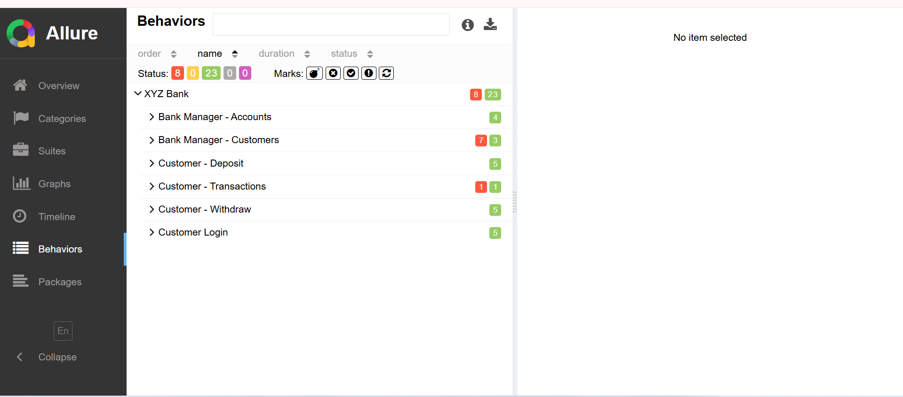
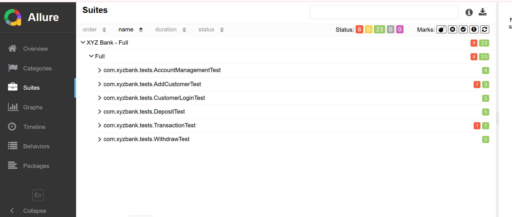

# Test Automation with Selenium WebDriver II — XYZ Bank Lab

[](https://github.com/123annick/selenium-II-lab/actions/workflows/ci.yml)

| | |
| --- | --- |
| **Author** | Annick Ujeneza |
| **Application under test** | [XYZ Bank App](https://www.globalsqa.com/angularJs-protractor/BankingProject/) |
| **Allure report (live)** | https://123annick.github.io/selenium-II-lab/ |
| **Jira / Xray (project TMLD4)** | Test Plan [TMLD4-104](https://amali-tech.atlassian.net/browse/TMLD4-104) · Test Execution [TMLD4-113](https://amali-tech.atlassian.net/browse/TMLD4-113) |
| **Test plan** | [`docs/TEST_PLAN.md`](docs/TEST_PLAN.md) · Jira [TMLD4-104](https://amali-tech.atlassian.net/browse/TMLD4-104) |
| **Manual testing evidence** | [`docs/`](docs/) — test workbook, Requirement & Defect Traceability Reports |
| **Stack** | Java 17 · Selenium WebDriver 4 · TestNG · Maven · Allure Report · Docker · GitHub Actions |

### Results at a glance

| Run | Tests | Passed | Failed | Not run | Notes |
| --- | --- | --- | --- | --- | --- |
| Manual (Xray TMLD4-113) | 64 | 43 | 20 | 1 | 20 defects logged; TC-064 Firefox out of scope |
| Automated – regression suite (CI gate) | 23 | 23 | 0 | 0 | Local, Docker and GitHub Actions |
| Automated – full suite | 31 | 23 | 8 | 0 | The 8 failures prove known defects BUG-001…007 and BUG-012 |

| Allure overview | Known defects in Allure |
| --- | --- |
|  |  |
| **Behaviors (by user story)** | **Suites** |
|  |  |
| **Tests in Docker** | **GitHub Actions** |
|  |  |

---

## Table of Contents

1. [How this submission maps to the grading scheme](#1-how-this-submission-maps-to-the-grading-scheme)
2. [Part A — Test Plan](#2-part-a--test-plan)
3. [Part B — Manual Testing](#3-part-b--manual-testing)
4. [Part C — Test Automation Framework](#4-part-c--test-automation-framework)
5. [Practice Task 1 — POM Refactor](#5-practice-task-1--pom-refactor)
6. [Practice Task 2 — Data-Driven Tests from CSV](#6-practice-task-2--data-driven-tests-from-csv)
7. [Practice Task 3 — Advanced Reporting with Allure](#7-practice-task-3--advanced-reporting-with-allure)
8. [Containerization with Docker](#8-containerization-with-docker)
9. [CI/CD with GitHub Actions](#9-cicd-with-github-actions)
10. [How to Run](#10-how-to-run)
11. [Discussion Prompt](#11-discussion-prompt)
12. [Best Practices Checklist](#12-best-practices-checklist)
13. [References](#13-references)

---

## 1. How this submission maps to the grading scheme

| Metric | Score | Where it is covered |
| --- | --- | --- |
| Test plan document | 10 | [`docs/TEST_PLAN.md`](docs/TEST_PLAN.md) and [Section 2](#2-part-a--test-plan) |
| Set up, folder structure (POM), test data, GitHub Actions CI, Docker | 70 | Sections [4](#4-part-c--test-automation-framework), [5](#5-practice-task-1--pom-refactor), [6](#6-practice-task-2--data-driven-tests-from-csv), [8](#8-containerization-with-docker), [9](#9-cicd-with-github-actions) |
| Test report with Allure | 20 | [Section 7](#7-practice-task-3--advanced-reporting-with-allure) |

---

## 2. Part A — Test Plan

> Standalone version of this plan: **[docs/TEST_PLAN.md](docs/TEST_PLAN.md)**

> Format based on IEEE 829 / ISO/IEC/IEEE 29119-3, trimmed to what this project needs.

### 2.1 Test plan identifier

`TP-XYZBANK-001` — version 1.0

### 2.2 Introduction

The XYZ Bank app is an AngularJS single-page banking demo with two roles:

- **Bank Manager** — add customers, open accounts, list/search/delete customers.
- **Customer** — log in by choosing their name, view transactions, deposit, withdraw.

This plan describes how the app will be tested manually and automatically against User Story 1 (Bank Manager) and User Story 2 (Customer).

### 2.3 Objectives

1. Verify every acceptance criterion of User Stories 1 and 2.
2. Find and report defects, especially in input validation and transaction security.
3. Build a maintainable Selenium WebDriver framework (Page Object Model, data-driven tests).
4. Run the suite in Docker and in a GitHub Actions CI pipeline on every push / pull request.
5. Publish an Allure report that both engineers and non-technical stakeholders can read.

### 2.4 Scope

| In scope | Out of scope |
| --- | --- |
| Customer login / logout | Performance, load and stress testing |
| Add customer (incl. name and post-code validation) | Security / penetration testing (only the "cannot reset history" rule is tested) |
| Open account (Dollar, Pound, Rupee) | Back-end / API testing (the app has no real back end; data lives in browser localStorage) |
| Customers list: search, delete | Accessibility audit, localisation |
| Deposit, withdraw, balance update | Mobile native apps |
| Transactions list and transaction-history integrity | Date-range filter on the Transactions page |
| Compatibility: Chrome (primary), Edge, phone-size screen (375 × 667) | Firefox, Safari |

### 2.5 Features to be tested (traceability)

Requirement IDs, test case IDs and Jira keys are the same as in the manual-testing workbook (`XYZ_Bank_Test_Workbook.xlsx`) and in Jira project **TMLD4** with Xray (test plan [TMLD4-104](https://amali-tech.atlassian.net/browse/TMLD4-104), test execution [TMLD4-113](https://amali-tech.atlassian.net/browse/TMLD4-113)). Coverage status comes from the Xray *Requirement Traceability Report*: **7 OK, 11 NOK, 1 NOT RUN** out of 19 requirements. Automated tests link to the same Xray keys with `@TmsLink`, so manual and automated results trace to the same requirements.

| Req ID | Jira key | Requirement | Manual test cases | Coverage status (Xray) | Automated (class → Xray key) |
| --- | --- | --- | --- | --- | --- |
| REQ-01 | [TMLD4-65](https://amali-tech.atlassian.net/browse/TMLD4-65) | Manager can add a new customer | TC-001 – TC-006 | OK | `AddCustomerTest` → TMLD4-1 |
| REQ-02 | [TMLD4-66](https://amali-tech.atlassian.net/browse/TMLD4-66) | Names: alphabetic characters only | TC-007 – TC-011 | NOK | `AddCustomerTest` → TMLD4-7 |
| REQ-03 | [TMLD4-67](https://amali-tech.atlassian.net/browse/TMLD4-67) | Post code: numeric characters only | TC-012 – TC-015 | NOK | `AddCustomerTest` → TMLD4-7 |
| REQ-04 | [TMLD4-68](https://amali-tech.atlassian.net/browse/TMLD4-68) | Manager can create an account for an existing customer | TC-016 – TC-021 | OK | `AccountManagementTest` → TMLD4-16 |
| REQ-05 | [TMLD4-69](https://amali-tech.atlassian.net/browse/TMLD4-69) | No access until an account is created | TC-022, TC-023 | OK | `AccountManagementTest` → TMLD4-22, TMLD4-23 |
| REQ-06 | [TMLD4-70](https://amali-tech.atlassian.net/browse/TMLD4-70) | Manager can delete customer accounts | TC-024 – TC-026, TC-029 | NOK | `AccountManagementTest` → TMLD4-24 |
| REQ-07 | [TMLD4-71](https://amali-tech.atlassian.net/browse/TMLD4-71) | Deleted customer can no longer access the account | TC-027, TC-028 | OK | `AccountManagementTest` → TMLD4-24 |
| REQ-08 | [TMLD4-72](https://amali-tech.atlassian.net/browse/TMLD4-72) | Customer can view recent transactions | TC-036 – TC-040 | OK | `TransactionTest` → TMLD4-31 |
| REQ-09 | [TMLD4-73](https://amali-tech.atlassian.net/browse/TMLD4-73) | Customer can enter a deposit amount | TC-044, TC-049 | NOK | — (browser validation) |
| REQ-10 | [TMLD4-74](https://amali-tech.atlassian.net/browse/TMLD4-74) | Deposit amount validated (positive value) | TC-045 – TC-048 | NOK | `DepositTest` → TMLD4-41 |
| REQ-11 | [TMLD4-75](https://amali-tech.atlassian.net/browse/TMLD4-75) | Balance updated after a deposit | TC-043, TC-050 | OK | `DepositTest` → TMLD4-41 |
| REQ-12 | [TMLD4-76](https://amali-tech.atlassian.net/browse/TMLD4-76) | Customer can enter a withdrawal amount | TC-057, TC-058 | NOK | — (browser validation) |
| REQ-13 | [TMLD4-77](https://amali-tech.atlassian.net/browse/TMLD4-77) | Withdrawal validated (positive, sufficient balance) | TC-052 – TC-056 | NOK | `WithdrawTest` → TMLD4-50 |
| REQ-14 | [TMLD4-78](https://amali-tech.atlassian.net/browse/TMLD4-78) | Balance updated after a withdrawal | TC-051, TC-059 | OK | `WithdrawTest` → TMLD4-50 |
| REQ-15 | [TMLD4-79](https://amali-tech.atlassian.net/browse/TMLD4-79) | Customer cannot reset or alter transaction history | TC-041, TC-042 | NOK | `TransactionTest` → TMLD4-52 |
| REQ-16 | [TMLD4-80](https://amali-tech.atlassian.net/browse/TMLD4-80) | Customer can log in and log out | TC-030 – TC-034 | NOK | `CustomerLoginTest` → TMLD4-54, TMLD4-57 |
| REQ-17 | [TMLD4-81](https://amali-tech.atlassian.net/browse/TMLD4-81) | Only a bank manager can reach manager functions | TC-035 | NOK | — (manual) |
| REQ-18 | [TMLD4-82](https://amali-tech.atlassian.net/browse/TMLD4-82) | Compatibility: Chrome, Edge, phone-size screen | TC-062, TC-063 | NOT RUN | — (manual) |
| REQ-19 | [TMLD4-83](https://amali-tech.atlassian.net/browse/TMLD4-83) | Labels and messages correctly spelled and styled | TC-060, TC-061 | NOK | — (manual) |

### 2.6 Test approach

| Level / type | How |
| --- | --- |
| Manual functional testing | 64 scripted test cases managed in Jira Xray (63 executed) — see [Section 3](#3-part-b--manual-testing) |
| Automated UI regression | Selenium WebDriver 4 + TestNG, Page Object Model |
| Data-driven testing | CSV files → TestNG `@DataProvider` (valid, boundary and negative values) |
| Test design techniques | Equivalence partitioning (valid / invalid names, amounts), boundary values (0, 1, exact balance, balance + 1), state transition (customer → account → deleted) |
| Smoke vs. regression | TestNG groups: `smoke`, `regression`, `known-defect` |
| Reporting | Allure (steps, screenshots on failure, severity, features/stories, trends) |
| CI | GitHub Actions: build Docker image → run suite against Selenium Grid container → Allure report artifact + GitHub Pages |

### 2.7 Test environment

| Item | Value |
| --- | --- |
| URL | https://www.globalsqa.com/angularJs-protractor/BankingProject/ |
| Browsers | Google Chrome 131 (64-bit) — primary; Microsoft Edge; phone-size viewport 375 × 667 (iPhone SE) |
| OS / screen | Windows 11, 1920 × 1080 (manual and local runs); Ubuntu (GitHub Actions / Docker) |
| Tools | Jira + Xray (test management, defects), Java 17, Maven 3.9, Selenium 4, TestNG 7, Allure 2, Docker, GitHub Actions, IntelliJ IDEA |
| Test data | Pre-loaded customers (Harry Potter, Hermoine Granger, Ron Weasly, Albus Dumbledore, Neville Longbottom) + generated customers |

### 2.8 Entry and exit criteria

**Entry:** application URL reachable · user stories and acceptance criteria agreed · environment and tools installed · test data prepared.

**Exit:** 100 % of planned test cases executed · 100 % of smoke and ≥ 95 % of regression tests passing · no open Critical/Blocker defect without an agreed decision · Allure report published · defects logged with steps, evidence and severity.

**Suspension:** app unavailable or a Blocker defect prevents login for both roles. **Resumption:** fix deployed and smoke suite green.

### 2.9 Risks and mitigations

| Risk | Impact | Mitigation |
| --- | --- | --- |
| Public demo site down / slow | Tests fail for reasons unrelated to code | Explicit waits, retry in CI only on infrastructure errors, report categorises timeouts separately |
| AngularJS re-renders forms (Deposit ↔ Withdrawl) | Flaky tests | Wait for the correct form label before typing |
| Data shared between tests | Order-dependent results | New browser per test (fresh localStorage) + generated unique customers |
| Known product defects break the CI gate | Pipeline always red | Defect-proving tests in `known-defect` group, run nightly (`full` suite), linked to the Jira bug with `@Issue` |
| Locator changes | High maintenance | Locators centralised in page objects; stable `ng-click` / `ng-model` / `id` attributes |

### 2.10 Roles and responsibilities

| Role | Responsibility |
| --- | --- |
| QA Engineer (Annick) | Test plan, manual testing, automation framework, CI/CD, reporting |
| Trainer / Reviewer | Review plan and code, sign-off |
| Product Owner | Clarify acceptance criteria, prioritise defects |

### 2.11 Schedule

| Phase | Effort |
| --- | --- |
| Requirement analysis & test plan | 0.5 day |
| Manual test design & execution | 1 day |
| Framework set-up (Maven, POM, config, data) | 1 day |
| Automated tests | 1.5 days |
| Docker + GitHub Actions + Allure | 1 day |
| Defect reporting, review, final report | 0.5 day |

### 2.12 Deliverables

Test plan (this document) · manual test cases & execution results · defect reports · automation source code (GitHub) · Dockerfile & docker-compose · GitHub Actions workflow · Allure report.

### 2.13 Defect management

| Severity | Meaning |
| --- | --- |
| Blocker | Core flow impossible (e.g. nobody can log in) |
| Critical | Security or data-integrity failure (e.g. unauthenticated access, history deleted) |
| High | Required function missing or destructive behaviour |
| Medium | Acceptance criterion violated, workaround exists |
| Low | Cosmetic or feedback issue, no money moves |

Defects are logged in Jira (project TMLD4) with: ID, description, steps, expected vs. actual, environment, severity and priority (each with a reason), linked test case and requirement, and screenshot evidence.

---

## 3. Part B — Manual Testing

Manual testing was executed on **14-Nov-2026** on Chrome 131 / Windows 11 (1920 × 1080), and on Edge and a 375 × 667 viewport for compatibility. Test cases, the traceability matrix and the defect log with screenshot evidence are in **`XYZ_Bank_Test_Workbook.xlsx`**. The same tests were executed in Jira Xray as test execution [TMLD4-113](https://amali-tech.atlassian.net/browse/TMLD4-113); the exported *Requirement Traceability Report* and *Defect Traceability Report* (`docs/`) show every requirement → test → run → defect link.

Techniques used: equivalence partitioning (valid/invalid names, post codes, amounts), boundary value analysis (0, 1, exact balance, balance + 1), and state transition (customer → account → deleted).

### 3.1 Execution summary

| Test suite | Total | Pass | Fail | Not run |
| --- | --- | --- | --- | --- |
| TS-01 Manager: Add Customer | 15 | 8 | 7 | 0 |
| TS-02 Manager: Open Account | 8 | 8 | 0 | 0 |
| TS-03 Manager: Delete Account | 6 | 4 | 2 | 0 |
| TS-04 Login and Access | 6 | 4 | 2 | 0 |
| TS-05 Customer: Transactions | 7 | 6 | 1 | 0 |
| TS-06 Customer: Deposit | 8 | 5 | 3 | 0 |
| TS-07 Customer: Withdraw | 9 | 6 | 3 | 0 |
| TS-08 Non-functional | 5 | 2 | 2 | 1 |
| **Total** | **64** | **43** | **20** | **1** |

Pass rate of executed tests: 43 of 63 (68 %). TC-064 (Firefox, Xray TMLD4-60) is kept in Xray but not run: Firefox is out of scope for this cycle (Test Plan TMLD4-104, section 9), so REQ-18 shows NOT RUN in the Requirement Traceability Report.

### 3.2 Defects found

| Bug ID | Jira | Summary | Severity | Priority | Test case | Req |
| --- | --- | --- | --- | --- | --- | --- |
| BUG-010 | [TMLD4-93](https://amali-tech.atlassian.net/browse/TMLD4-93) | Customer login needs no password; any account can be opened | Critical | High | TC-032 | REQ-16 |
| BUG-011 | [TMLD4-94](https://amali-tech.atlassian.net/browse/TMLD4-94) | Manager functions reachable without credentials, also by direct URL | Critical | High | TC-035 | REQ-17 |
| BUG-012 | [TMLD4-95](https://amali-tech.atlassian.net/browse/TMLD4-95) | Customer can clear transaction history with **Reset** | Critical | High | TC-041 | REQ-15 |
| BUG-008 | [TMLD4-91](https://amali-tech.atlassian.net/browse/TMLD4-91) | No single-account delete; Delete removes the customer and all accounts | High | High | TC-025 | REQ-06 |
| BUG-009 | [TMLD4-92](https://amali-tech.atlassian.net/browse/TMLD4-92) | Customer deleted immediately, no confirmation | High | Medium | TC-026 | REQ-06 |
| BUG-001 | [TMLD4-84](https://amali-tech.atlassian.net/browse/TMLD4-84) | First Name accepts digits | Medium | High | TC-007 | REQ-02 |
| BUG-002 | [TMLD4-85](https://amali-tech.atlassian.net/browse/TMLD4-85) | Last Name accepts digits | Medium | High | TC-008 | REQ-02 |
| BUG-003 | [TMLD4-86](https://amali-tech.atlassian.net/browse/TMLD4-86) | First Name accepts special characters | Medium | High | TC-009 | REQ-02 |
| BUG-004 | [TMLD4-87](https://amali-tech.atlassian.net/browse/TMLD4-87) | Last Name accepts special characters | Medium | High | TC-010 | REQ-02 |
| BUG-005 | [TMLD4-88](https://amali-tech.atlassian.net/browse/TMLD4-88) | Post Code accepts letters | Medium | High | TC-012 | REQ-03 |
| BUG-006 | [TMLD4-89](https://amali-tech.atlassian.net/browse/TMLD4-89) | Post Code accepts letters and digits mixed | Medium | High | TC-013 | REQ-03 |
| BUG-007 | [TMLD4-90](https://amali-tech.atlassian.net/browse/TMLD4-90) | Post Code accepts special characters | Medium | High | TC-014 | REQ-03 |
| BUG-013 | [TMLD4-96](https://amali-tech.atlassian.net/browse/TMLD4-96) | Deposit rejects decimal amounts (10.50) | Medium | Medium | TC-049 | REQ-09 |
| BUG-014 | [TMLD4-97](https://amali-tech.atlassian.net/browse/TMLD4-97) | Withdrawal rejects decimal amounts (5.25) | Medium | Medium | TC-058 | REQ-12 |
| BUG-017 | [TMLD4-100](https://amali-tech.atlassian.net/browse/TMLD4-100) | Deposit of 0: no validation message | Low | Medium | TC-045 | REQ-10 |
| BUG-018 | [TMLD4-101](https://amali-tech.atlassian.net/browse/TMLD4-101) | Negative deposit: no validation message | Low | Medium | TC-046 | REQ-10 |
| BUG-019 | [TMLD4-102](https://amali-tech.atlassian.net/browse/TMLD4-102) | Withdrawal of 0: no validation message | Low | Medium | TC-055 | REQ-13 |
| BUG-020 | [TMLD4-103](https://amali-tech.atlassian.net/browse/TMLD4-103) | Negative withdrawal: no validation message | Low | Medium | TC-056 | REQ-13 |
| BUG-015 | [TMLD4-98](https://amali-tech.atlassian.net/browse/TMLD4-98) | Button label misspelled "Withdrawl" | Low | Medium | TC-060 | REQ-19 |
| BUG-016 | [TMLD4-99](https://amali-tech.atlassian.net/browse/TMLD4-99) | "Deposit Successful" shown in red error style | Low | Low | TC-061 | REQ-19 |

### 3.3 What manual testing changed in the automation

- **Zero and negative amounts** (BUG-017 to BUG-020): the app moves no money and records no transaction, but shows no message. The automated deposit and withdraw tests therefore check that the **balance is unchanged and no success message appears** — these rows pass. The missing message stays a logged defect.
- **Invalid names and post codes** (BUG-001 to BUG-007) and **Reset** (BUG-012) are automated in the `known-defect` group and linked to their Jira bugs with `@Issue`, so they show in the nightly report without blocking the CI gate.
- **New transactions sometimes do not appear** (manual note in TC-037). Automation found the cause in the app's `date.search.filter.js`: the start/end date filters are pre-filled with times that include milliseconds, the `datetime-local` inputs only accept whole seconds, so the values become invalid and the filter `date >= start && date <= end` hides every row. `TransactionsPage.waitForTransactions()` widens the date range so the test can verify the transactions. Candidate defect **BUG-021** (Medium, REQ-08).
- **Authentication, confirmation dialogs, decimals and styling** (BUG-008 to BUG-011, BUG-013 to BUG-016) stay manual: they are missing features or visual checks, not regressions a UI script should guard.
- The automated CSV data uses the **same values as the manual test cases** (e.g. `John123`, `Sm#th`, `12AB5`, `100`/`101` for withdrawal boundaries).

---

## 4. Part C — Test Automation Framework

### 4.1 Tech stack and why

| Tool | Purpose | Why |
| --- | --- | --- |
| Selenium WebDriver 4 | Browser automation | W3C standard; **Selenium Manager** downloads the right driver automatically |
| TestNG | Runner | Groups, parallel execution, `@DataProvider`, XML suites |
| Maven | Build & dependencies | Standard; runs the same way locally, in Docker and in CI |
| Apache Commons CSV | Read test data | Small, reliable CSV parser (handles quotes, headers, trimming) |
| Allure TestNG | Reporting | `@Step`, `@Feature`, severity, attachments, history/trends |
| Docker + Selenium Grid image | Isolated, reproducible runs | Same browser version everywhere |
| GitHub Actions | CI/CD | Runs on every push/PR, publishes the report |

### 4.2 Folder structure (Page Object Model)

```
xyz-bank-automation/
├── .github/workflows/ci.yml              # CI pipeline
├── Dockerfile                            # test-runner image
├── docker-compose.yml                    # runner + Selenium Grid (Chrome)
├── .dockerignore / .gitignore
├── pom.xml
└── src/test/
    ├── java/com/xyzbank/
    │   ├── config/ConfigReader.java      # properties + env/system overrides
    │   ├── driver/
    │   │   ├── DriverFactory.java        # local or remote browser, options
    │   │   └── DriverManager.java        # ThreadLocal driver (parallel safe)
    │   ├── base/BaseTest.java            # setup / teardown only
    │   ├── pages/                        # Page Objects: locators + actions, NO assertions
    │   │   ├── BasePage.java
    │   │   ├── HomePage.java
    │   │   ├── CustomerLoginPage.java
    │   │   ├── ManagerPage.java
    │   │   ├── AddCustomerPage.java
    │   │   ├── OpenAccountPage.java
    │   │   ├── CustomersPage.java
    │   │   ├── AccountPage.java
    │   │   └── TransactionsPage.java
    │   ├── tests/                        # test logic + assertions ONLY
    │   │   ├── CustomerLoginTest.java
    │   │   ├── AddCustomerTest.java
    │   │   ├── AccountManagementTest.java
    │   │   ├── DepositTest.java
    │   │   ├── WithdrawTest.java
    │   │   └── TransactionTest.java
    │   ├── dataproviders/TestDataProviders.java
    │   ├── listeners/AllureTestListener.java   # screenshot on failure, env info
    │   └── utils/
    │       ├── CsvDataReader.java
    │       └── TestDataGenerator.java
    └── resources/
        ├── config.properties
        ├── allure.properties
        ├── categories.json
        ├── suites/ smoke.xml · regression.xml · full.xml
        └── testdata/ customer_login.csv · add_customer.csv · deposit.csv · withdraw.csv
```

**Layer rules**

- **Tests** describe *what* is checked and hold every assertion. They never call `driver.findElement`.
- **Pages** describe *how* to interact with a screen. They return other pages (fluent navigation) and never assert.
- **Framework** (`config`, `driver`, `base`, `utils`, `listeners`) is reusable in any project.
- **Data** lives in `resources/testdata`, outside the code.

### 4.3 `pom.xml`

**`pom.xml`**

```xml
<?xml version="1.0" encoding="UTF-8"?>
<project xmlns="http://maven.apache.org/POM/4.0.0"
         xmlns:xsi="http://www.w3.org/2001/XMLSchema-instance"
         xsi:schemaLocation="http://maven.apache.org/POM/4.0.0 http://maven.apache.org/xsd/maven-4.0.0.xsd">
    <modelVersion>4.0.0</modelVersion>

    <groupId>com.xyzbank</groupId>
    <artifactId>xyz-bank-automation</artifactId>
    <version>1.0.0</version>
    <name>XYZ Bank - Selenium WebDriver Test Automation</name>

    <properties>
        <maven.compiler.release>17</maven.compiler.release>
        <project.build.sourceEncoding>UTF-8</project.build.sourceEncoding>

        <!-- Dependency versions kept in one place -->
        <selenium.version>4.27.0</selenium.version>
        <testng.version>7.10.2</testng.version>
        <allure.version>2.29.0</allure.version>
        <aspectj.version>1.9.22.1</aspectj.version>
        <commons-csv.version>1.12.0</commons-csv.version>
        <slf4j.version>2.0.16</slf4j.version>

        <!-- Plugin versions -->
        <surefire.version>3.5.2</surefire.version>
        <allure-maven.version>2.15.2</allure-maven.version>

        <!-- Default suite; override with -Dsuite=smoke -->
        <suite>regression</suite>
    </properties>

    <dependencies>
        <!-- Selenium 4 (includes Selenium Manager: no manual driver download needed) -->
        <dependency>
            <groupId>org.seleniumhq.selenium</groupId>
            <artifactId>selenium-java</artifactId>
            <version>${selenium.version}</version>
        </dependency>

        <!-- Test runner -->
        <dependency>
            <groupId>org.testng</groupId>
            <artifactId>testng</artifactId>
            <version>${testng.version}</version>
            <scope>test</scope>
        </dependency>

        <!-- Allure integration for TestNG (@Step, @Feature, attachments...) -->
        <dependency>
            <groupId>io.qameta.allure</groupId>
            <artifactId>allure-testng</artifactId>
            <version>${allure.version}</version>
            <scope>test</scope>
        </dependency>

        <!-- CSV reading for data-driven tests -->
        <dependency>
            <groupId>org.apache.commons</groupId>
            <artifactId>commons-csv</artifactId>
            <version>${commons-csv.version}</version>
            <scope>test</scope>
        </dependency>

        <!-- Logging -->
        <dependency>
            <groupId>org.slf4j</groupId>
            <artifactId>slf4j-simple</artifactId>
            <version>${slf4j.version}</version>
            <scope>test</scope>
        </dependency>
    </dependencies>

    <build>
        <plugins>
            <plugin>
                <groupId>org.apache.maven.plugins</groupId>
                <artifactId>maven-compiler-plugin</artifactId>
                <version>3.13.0</version>
                <configuration>
                    <!-- keeps parameter names so Allure can render @Step("Enter '{amount}'") -->
                    <parameters>true</parameters>
                </configuration>
            </plugin>

            <plugin>
                <groupId>org.apache.maven.plugins</groupId>
                <artifactId>maven-surefire-plugin</artifactId>
                <version>${surefire.version}</version>
                <configuration>
                    <suiteXmlFiles>
                        <suiteXmlFile>src/test/resources/suites/${suite}.xml</suiteXmlFile>
                    </suiteXmlFiles>
                    <!-- AspectJ weaver is required for Allure @Step / @Attachment to work -->
                    <argLine>
                        -javaagent:"${settings.localRepository}/org/aspectj/aspectjweaver/${aspectj.version}/aspectjweaver-${aspectj.version}.jar"
                    </argLine>
                    <systemPropertyVariables>
                        <allure.results.directory>${project.build.directory}/allure-results</allure.results.directory>
                    </systemPropertyVariables>
                </configuration>
                <dependencies>
                    <dependency>
                        <groupId>org.aspectj</groupId>
                        <artifactId>aspectjweaver</artifactId>
                        <version>${aspectj.version}</version>
                    </dependency>
                </dependencies>
            </plugin>

            <!-- mvn allure:serve  (local)  |  mvn allure:report (static HTML in target/site/allure-maven-plugin) -->
            <plugin>
                <groupId>io.qameta.allure</groupId>
                <artifactId>allure-maven</artifactId>
                <version>${allure-maven.version}</version>
                <configuration>
                    <reportVersion>${allure.version}</reportVersion>
                    <resultsDirectory>allure-results</resultsDirectory>
                </configuration>
            </plugin>
        </plugins>
    </build>
</project>
```

### 4.4 Configuration — `config.properties` and `ConfigReader`

Every value can be overridden without code changes: `mvn test -Dbrowser=firefox -Dheadless=true` or as environment variables (`BROWSER`, `HEADLESS`, `GRID_URL`) in Docker/CI.

**`src/test/resources/config.properties`**

```properties
# ---------------------------------------------------------------
# Default configuration. Every key can be overridden by:
#   1. a JVM system property   ->  mvn test -Dbrowser=firefox
#   2. an environment variable ->  BROWSER=firefox (dots become _ and UPPERCASE)
# ---------------------------------------------------------------
base.url=https://www.globalsqa.com/angularJs-protractor/BankingProject/#/login
browser=chrome
headless=false
# Empty = run locally. Set to http://selenium:4444 (Docker) to use a Selenium Grid
grid.url=
explicit.wait.seconds=10
page.load.timeout.seconds=30
```

**`src/test/java/com/xyzbank/config/ConfigReader.java`**

```java
package com.xyzbank.config;

import java.io.IOException;
import java.io.InputStream;
import java.util.Properties;

/**
 * Single source of configuration.
 * Lookup order: JVM system property -> environment variable -> config.properties.
 * This lets CI/Docker change behaviour without touching code.
 */
public final class ConfigReader {

    private static final Properties PROPS = new Properties();

    static {
        try (InputStream in = ConfigReader.class.getClassLoader().getResourceAsStream("config.properties")) {
            if (in == null) {
                throw new IllegalStateException("config.properties not found on the classpath");
            }
            PROPS.load(in);
        } catch (IOException e) {
            throw new IllegalStateException("Could not load config.properties", e);
        }
    }

    private ConfigReader() {
    }

    public static String get(String key) {
        String sys = System.getProperty(key);
        if (sys != null && !sys.isBlank()) {
            return sys.trim();
        }
        String env = System.getenv(key.replace('.', '_').toUpperCase());
        if (env != null && !env.isBlank()) {
            return env.trim();
        }
        return PROPS.getProperty(key, "").trim();
    }

    public static String baseUrl() {
        return get("base.url");
    }

    public static String browser() {
        return get("browser").toLowerCase();
    }

    public static boolean headless() {
        return Boolean.parseBoolean(get("headless"));
    }

    public static String gridUrl() {
        return get("grid.url");
    }

    public static int explicitWaitSeconds() {
        return Integer.parseInt(get("explicit.wait.seconds"));
    }

    public static int pageLoadTimeoutSeconds() {
        return Integer.parseInt(get("page.load.timeout.seconds"));
    }
}
```

### 4.5 Driver management

`DriverFactory` builds a local driver, or a `RemoteWebDriver` when `grid.url` is set (Docker/CI). `DriverManager` keeps one driver **per thread** so suites can run in parallel.

**`src/test/java/com/xyzbank/driver/DriverFactory.java`**

```java
package com.xyzbank.driver;

import com.xyzbank.config.ConfigReader;
import org.openqa.selenium.MutableCapabilities;
import org.openqa.selenium.WebDriver;
import org.openqa.selenium.chrome.ChromeDriver;
import org.openqa.selenium.chrome.ChromeOptions;
import org.openqa.selenium.edge.EdgeDriver;
import org.openqa.selenium.edge.EdgeOptions;
import org.openqa.selenium.firefox.FirefoxDriver;
import org.openqa.selenium.firefox.FirefoxOptions;
import org.openqa.selenium.remote.RemoteWebDriver;

import java.net.MalformedURLException;
import java.net.URI;
import java.time.Duration;

/**
 * Creates WebDriver instances. Drivers are resolved automatically by Selenium Manager,
 * so no WebDriverManager / chromedriver.exe in the repository.
 * If grid.url is set (Docker / CI) a RemoteWebDriver is created instead.
 */
public final class DriverFactory {

    private DriverFactory() {
    }

    public static WebDriver createDriver() {
        MutableCapabilities options = buildOptions(ConfigReader.browser(), ConfigReader.headless());
        String gridUrl = ConfigReader.gridUrl();

        WebDriver driver;
        if (!gridUrl.isEmpty()) {
            try {
                driver = new RemoteWebDriver(URI.create(gridUrl).toURL(), options);
            } catch (MalformedURLException e) {
                throw new IllegalArgumentException("Invalid grid.url: " + gridUrl, e);
            }
        } else {
            driver = switch (ConfigReader.browser()) {
                case "firefox" -> new FirefoxDriver((FirefoxOptions) options);
                case "edge" -> new EdgeDriver((EdgeOptions) options);
                default -> new ChromeDriver((ChromeOptions) options);
            };
        }

        // Best practice: never mix implicit and explicit waits -> implicit wait stays at 0.
        driver.manage().timeouts().pageLoadTimeout(Duration.ofSeconds(ConfigReader.pageLoadTimeoutSeconds()));
        if (!ConfigReader.headless()) {
            driver.manage().window().maximize();
        }
        return driver;
    }

    private static MutableCapabilities buildOptions(String browser, boolean headless) {
        switch (browser) {
            case "firefox": {
                FirefoxOptions ff = new FirefoxOptions();
                if (headless) {
                    ff.addArguments("-headless");
                }
                ff.addArguments("--width=1920", "--height=1080");
                return ff;
            }
            case "edge": {
                EdgeOptions edge = new EdgeOptions();
                if (headless) {
                    edge.addArguments("--headless=new");
                }
                edge.addArguments("--window-size=1920,1080");
                return edge;
            }
            default: {
                ChromeOptions chrome = new ChromeOptions();
                if (headless) {
                    chrome.addArguments("--headless=new");
                }
                chrome.addArguments("--window-size=1920,1080", "--no-sandbox",
                        "--disable-dev-shm-usage", "--disable-search-engine-choice-screen");
                return chrome;
            }
        }
    }
}
```

**`src/test/java/com/xyzbank/driver/DriverManager.java`**

```java
package com.xyzbank.driver;

import org.openqa.selenium.WebDriver;

/**
 * Thread-safe holder so tests can run in parallel: every thread owns its own browser.
 */
public final class DriverManager {

    private static final ThreadLocal<WebDriver> DRIVER = new ThreadLocal<>();

    private DriverManager() {
    }

    public static WebDriver getDriver() {
        WebDriver driver = DRIVER.get();
        if (driver == null) {
            throw new IllegalStateException("WebDriver has not been initialised for this thread");
        }
        return driver;
    }

    public static boolean hasDriver() {
        return DRIVER.get() != null;
    }

    public static void initDriver() {
        DRIVER.set(DriverFactory.createDriver());
    }

    public static void quitDriver() {
        WebDriver driver = DRIVER.get();
        if (driver != null) {
            try {
                driver.quit();
            } finally {
                DRIVER.remove();
            }
        }
    }
}
```

### 4.6 Page objects

`BasePage` centralises **explicit waits** (no `Thread.sleep`, no implicit waits) and common actions.

**`src/test/java/com/xyzbank/pages/BasePage.java`**

```java
package com.xyzbank.pages;

import com.xyzbank.config.ConfigReader;
import com.xyzbank.driver.DriverManager;
import org.openqa.selenium.Alert;
import org.openqa.selenium.By;
import org.openqa.selenium.WebDriver;
import org.openqa.selenium.WebElement;
import org.openqa.selenium.support.ui.ExpectedConditions;
import org.openqa.selenium.support.ui.Select;
import org.openqa.selenium.support.ui.WebDriverWait;

import java.time.Duration;
import java.util.List;

/**
 * Parent of every page object. Holds the driver, the explicit wait and
 * small, reusable, synchronised interactions. Tests never call these directly.
 */
public abstract class BasePage {

    protected final WebDriver driver;
    protected final WebDriverWait wait;

    protected BasePage() {
        this.driver = DriverManager.getDriver();
        this.wait = new WebDriverWait(driver, Duration.ofSeconds(ConfigReader.explicitWaitSeconds()));
    }

    protected WebElement visible(By locator) {
        return wait.until(ExpectedConditions.visibilityOfElementLocated(locator));
    }

    protected void click(By locator) {
        wait.until(ExpectedConditions.elementToBeClickable(locator)).click();
    }

    protected void type(By locator, String text) {
        WebElement element = visible(locator);
        element.clear();
        element.sendKeys(text);
    }

    protected String textOf(By locator) {
        return visible(locator).getText().trim();
    }

    protected boolean isDisplayed(By locator) {
        List<WebElement> elements = driver.findElements(locator);
        return !elements.isEmpty() && elements.get(0).isDisplayed();
    }

    protected Select select(By locator) {
        return new Select(visible(locator));
    }

    protected boolean hasOption(By selectLocator, String visibleText) {
        return select(selectLocator).getOptions().stream()
                .anyMatch(option -> option.getText().trim().equals(visibleText));
    }

    /** Waits for a JavaScript alert, accepts it and returns its text. */
    protected String acceptAlertAndGetText() {
        Alert alert = wait.until(ExpectedConditions.alertIsPresent());
        String text = alert.getText();
        alert.accept();
        return text;
    }

    /** Returns the alert text if an alert shows up shortly, otherwise null. */
    protected String acceptAlertIfPresent(Duration timeout) {
        try {
            Alert alert = new WebDriverWait(driver, timeout).until(ExpectedConditions.alertIsPresent());
            String text = alert.getText();
            alert.accept();
            return text;
        } catch (org.openqa.selenium.TimeoutException e) {
            return null;
        }
    }
}
```

**`src/test/java/com/xyzbank/pages/HomePage.java`**

```java
package com.xyzbank.pages;

import com.xyzbank.config.ConfigReader;
import io.qameta.allure.Step;
import org.openqa.selenium.By;

/** Landing page: choose Customer Login or Bank Manager Login. */
public class HomePage extends BasePage {

    private final By customerLoginButton = By.cssSelector("button[ng-click='customer()']");
    private final By managerLoginButton = By.cssSelector("button[ng-click='manager()']");

    @Step("Open XYZ Bank home page")
    public HomePage open() {
        driver.get(ConfigReader.baseUrl());
        visible(customerLoginButton);
        return this;
    }

    @Step("Click 'Customer Login'")
    public CustomerLoginPage goToCustomerLogin() {
        click(customerLoginButton);
        return new CustomerLoginPage();
    }

    @Step("Click 'Bank Manager Login'")
    public ManagerPage goToManagerLogin() {
        click(managerLoginButton);
        return new ManagerPage();
    }
}
```

**`src/test/java/com/xyzbank/pages/CustomerLoginPage.java`**

```java
package com.xyzbank.pages;

import io.qameta.allure.Step;
import org.openqa.selenium.By;

/** Customer "login": the customer picks their name and presses Login. */
public class CustomerLoginPage extends BasePage {

    private final By customerDropdown = By.id("userSelect");
    private final By loginButton = By.cssSelector("form button[type='submit']");

    public CustomerLoginPage() {
        visible(customerDropdown);
    }

    @Step("Check if customer '{customerName}' is listed")
    public boolean isCustomerListed(String customerName) {
        return hasOption(customerDropdown, customerName);
    }

    @Step("Select customer '{customerName}'")
    public CustomerLoginPage selectCustomer(String customerName) {
        select(customerDropdown).selectByVisibleText(customerName);
        return this;
    }

    @Step("Click 'Login'")
    public AccountPage clickLogin() {
        click(loginButton);
        return new AccountPage();
    }

    /** Convenience flow used by most customer tests. */
    @Step("Log in as customer '{customerName}'")
    public AccountPage loginAs(String customerName) {
        return selectCustomer(customerName).clickLogin();
    }
}
```

**`src/test/java/com/xyzbank/pages/ManagerPage.java`**

```java
package com.xyzbank.pages;

import io.qameta.allure.Step;
import org.openqa.selenium.By;

/** Bank Manager landing page with the three tabs. */
public class ManagerPage extends BasePage {

    private final By addCustomerTab = By.cssSelector("button[ng-click='addCust()']");
    private final By openAccountTab = By.cssSelector("button[ng-click='openAccount()']");
    private final By customersTab = By.cssSelector("button[ng-click='showCust()']");

    public ManagerPage() {
        visible(addCustomerTab);
    }

    @Step("Open 'Add Customer' tab")
    public AddCustomerPage openAddCustomer() {
        click(addCustomerTab);
        return new AddCustomerPage();
    }

    @Step("Open 'Open Account' tab")
    public OpenAccountPage openOpenAccount() {
        click(openAccountTab);
        return new OpenAccountPage();
    }

    @Step("Open 'Customers' tab")
    public CustomersPage openCustomers() {
        click(customersTab);
        return new CustomersPage();
    }
}
```

**`src/test/java/com/xyzbank/pages/AddCustomerPage.java`**

```java
package com.xyzbank.pages;

import io.qameta.allure.Step;
import org.openqa.selenium.By;

import java.time.Duration;

public class AddCustomerPage extends ManagerPage {

    private final By firstNameInput = By.cssSelector("input[ng-model='fName']");
    private final By lastNameInput = By.cssSelector("input[ng-model='lName']");
    private final By postCodeInput = By.cssSelector("input[ng-model='postCd']");
    private final By addCustomerButton = By.cssSelector("form button[type='submit']");

    public AddCustomerPage() {
        visible(firstNameInput);
    }

    @Step("Enter first name '{firstName}'")
    public AddCustomerPage enterFirstName(String firstName) {
        type(firstNameInput, firstName);
        return this;
    }

    @Step("Enter last name '{lastName}'")
    public AddCustomerPage enterLastName(String lastName) {
        type(lastNameInput, lastName);
        return this;
    }

    @Step("Enter post code '{postCode}'")
    public AddCustomerPage enterPostCode(String postCode) {
        type(postCodeInput, postCode);
        return this;
    }

    /**
     * Submits the form and returns the confirmation alert text,
     * or null when the application shows no alert (input rejected).
     */
    @Step("Click 'Add Customer' and read confirmation")
    public String submit() {
        click(addCustomerButton);
        return acceptAlertIfPresent(Duration.ofSeconds(3));
    }

    @Step("Add customer {firstName} {lastName} ({postCode})")
    public String addCustomer(String firstName, String lastName, String postCode) {
        return enterFirstName(firstName).enterLastName(lastName).enterPostCode(postCode).submit();
    }
}
```

**`src/test/java/com/xyzbank/pages/OpenAccountPage.java`**

```java
package com.xyzbank.pages;

import io.qameta.allure.Step;
import org.openqa.selenium.By;

public class OpenAccountPage extends ManagerPage {

    private final By customerDropdown = By.id("userSelect");
    private final By currencyDropdown = By.id("currency");
    private final By processButton = By.cssSelector("form button[type='submit']");

    public OpenAccountPage() {
        visible(customerDropdown);
    }

    @Step("Select customer '{customerName}'")
    public OpenAccountPage selectCustomer(String customerName) {
        select(customerDropdown).selectByVisibleText(customerName);
        return this;
    }

    @Step("Select currency '{currency}'")
    public OpenAccountPage selectCurrency(String currency) {
        select(currencyDropdown).selectByVisibleText(currency);
        return this;
    }

    @Step("Click 'Process' and read confirmation")
    public String process() {
        click(processButton);
        return acceptAlertAndGetText();
    }

    /** @return the new account number parsed from the confirmation alert */
    @Step("Open {currency} account for '{customerName}'")
    public String openAccount(String customerName, String currency) {
        String alertText = selectCustomer(customerName).selectCurrency(currency).process();
        // e.g. "Account created successfully with account Number :1016"
        return alertText.substring(alertText.lastIndexOf(':') + 1).trim();
    }
}
```

**`src/test/java/com/xyzbank/pages/CustomersPage.java`**

```java
package com.xyzbank.pages;

import io.qameta.allure.Step;
import org.openqa.selenium.By;
import org.openqa.selenium.WebElement;

import java.util.List;

public class CustomersPage extends ManagerPage {

    private final By searchInput = By.cssSelector("input[ng-model='searchCustomer']");
    private final By tableRows = By.cssSelector("table tbody tr");
    private final By deleteButton = By.cssSelector("button[ng-click='deleteCust(cust)']");

    public CustomersPage() {
        visible(searchInput);
    }

    @Step("Search customers for '{text}'")
    public CustomersPage search(String text) {
        type(searchInput, text);
        return this;
    }

    public List<WebElement> rows() {
        return driver.findElements(tableRows);
    }

    @Step("Check customer '{firstName} {lastName}' is in the table")
    public boolean isCustomerPresent(String firstName, String lastName) {
        search(firstName);
        return rows().stream().anyMatch(row -> row.getText().startsWith(firstName + " " + lastName));
    }

    @Step("Read account numbers of '{firstName}'")
    public String accountNumbersOf(String firstName) {
        search(firstName);
        // columns: First Name | Last Name | Post Code | Account Number | Delete
        return rows().get(0).findElements(By.tagName("td")).get(3).getText().trim();
    }

    @Step("Delete customer '{firstName} {lastName}'")
    public CustomersPage deleteCustomer(String firstName, String lastName) {
        search(firstName);
        WebElement row = rows().stream()
                .filter(r -> r.getText().startsWith(firstName + " " + lastName))
                .findFirst()
                .orElseThrow(() -> new IllegalStateException("Customer not found: " + firstName + " " + lastName));
        row.findElement(deleteButton).click();
        return this;
    }
}
```

**`src/test/java/com/xyzbank/pages/AccountPage.java`**

```java
package com.xyzbank.pages;

import io.qameta.allure.Step;
import org.openqa.selenium.By;
import org.openqa.selenium.TimeoutException;
import org.openqa.selenium.WebElement;
import org.openqa.selenium.support.ui.ExpectedConditions;
import org.openqa.selenium.support.ui.WebDriverWait;

import java.time.Duration;
import java.util.List;

/** Customer dashboard: account info + Transactions / Deposit / Withdrawl. */
public class AccountPage extends BasePage {

    private final By welcomeName = By.cssSelector("span.fontBig");
    private final By accountDropdown = By.id("accountSelect");
    private final By accountInfoValues = By.cssSelector("div.center strong");
    private final By noAccountMessage = By.cssSelector("span[ng-show='noAccount']");

    private final By transactionsTab = By.cssSelector("button[ng-click='transactions()']");
    private final By depositTab = By.cssSelector("button[ng-click='deposit()']");
    private final By withdrawTab = By.cssSelector("button[ng-click='withdrawl()']");
    private final By logoutButton = By.cssSelector("button.logout");

    private final By formLabel = By.cssSelector("form[name='myForm'] label");
    private final By amountInput = By.cssSelector("input[ng-model='amount']");
    private final By submitButton = By.cssSelector("form[name='myForm'] button[type='submit']");
    private final By statusMessage = By.cssSelector("span.error");

    public AccountPage() {
        visible(welcomeName);
    }

    // ---------- account information ----------

    @Step("Read welcome name")
    public String welcomeName() {
        return textOf(welcomeName);
    }

    public boolean hasAccount() {
        return isDisplayed(accountDropdown) && !isDisplayed(noAccountMessage);
    }

    public boolean isNoAccountMessageShown() {
        return isDisplayed(noAccountMessage);
    }

    @Step("Select account '{accountNumber}'")
    public AccountPage selectAccount(String accountNumber) {
        select(accountDropdown).selectByVisibleText(accountNumber);
        return this;
    }

    private List<WebElement> accountInfo() {
        return wait.until(ExpectedConditions.numberOfElementsToBeMoreThan(accountInfoValues, 2));
    }

    public String accountNumber() {
        return accountInfo().get(0).getText().trim();
    }

    @Step("Read current balance")
    public int balance() {
        return Integer.parseInt(accountInfo().get(1).getText().trim());
    }

    /** Waits until the balance shown on screen equals the expected value. */
    @Step("Wait for balance to become {expected}")
    public int waitForBalance(int expected) {
        wait.until(d -> balance() == expected);
        return balance();
    }

    // ---------- deposit ----------

    @Step("Open 'Deposit' tab")
    public AccountPage openDeposit() {
        click(depositTab);
        wait.until(ExpectedConditions.textToBePresentInElementLocated(formLabel, "Deposited"));
        return this;
    }

    @Step("Enter amount '{amount}'")
    public AccountPage enterAmount(String amount) {
        type(amountInput, amount);
        return this;
    }

    @Step("Click 'Deposit'")
    public AccountPage clickDeposit() {
        click(submitButton);
        return this;
    }

    @Step("Deposit {amount}")
    public AccountPage deposit(String amount) {
        return openDeposit().enterAmount(amount).clickDeposit();
    }

    // ---------- withdraw ----------

    @Step("Open 'Withdrawl' tab")
    public AccountPage openWithdraw() {
        click(withdrawTab);
        // The form is re-rendered by AngularJS: wait for the correct label
        // to avoid typing into the old Deposit form (classic flaky spot).
        wait.until(ExpectedConditions.textToBePresentInElementLocated(formLabel, "Withdrawn"));
        return this;
    }

    @Step("Click 'Withdraw'")
    public AccountPage clickWithdraw() {
        click(submitButton);
        return this;
    }

    @Step("Withdraw {amount}")
    public AccountPage withdraw(String amount) {
        return openWithdraw().enterAmount(amount).clickWithdraw();
    }

    /**
     * Message under the form, e.g. "Deposit Successful".
     * Waits briefly for it to appear; returns an empty string if the app shows nothing.
     */
    @Step("Read status message")
    public String statusMessage() {
        try {
            return new WebDriverWait(driver, Duration.ofSeconds(2)).until(d -> {
                List<WebElement> messages = d.findElements(statusMessage);
                String text = messages.isEmpty() ? "" : messages.get(0).getText().trim();
                return text.isEmpty() ? null : text;
            });
        } catch (TimeoutException e) {
            return "";
        }
    }

    // ---------- navigation ----------

    @Step("Open 'Transactions' tab")
    public TransactionsPage openTransactions() {
        click(transactionsTab);
        return new TransactionsPage();
    }

    @Step("Log out")
    public CustomerLoginPage logout() {
        click(logoutButton);
        return new CustomerLoginPage();
    }
}
```

**`src/test/java/com/xyzbank/pages/TransactionsPage.java`**

```java
package com.xyzbank.pages;

import io.qameta.allure.Step;
import org.openqa.selenium.By;
import org.openqa.selenium.JavascriptExecutor;
import org.openqa.selenium.WebElement;
import org.openqa.selenium.support.ui.WebDriverWait;

import java.time.Duration;
import java.util.List;
import java.util.stream.Collectors;

public class TransactionsPage extends BasePage {

    private final By transactionRows = By.cssSelector("table tbody tr");
    private final By resetButton = By.cssSelector("button[ng-click='reset()']");
    private final By backButton = By.cssSelector("button[ng-click='back()']");
    private final By transactionsTable = By.cssSelector("table.table");
    private final By transactionsTab = By.cssSelector("button[ng-click='transactions()']");

    public TransactionsPage() {
        visible(backButton);
    }

    public List<WebElement> rows() {
        return driver.findElements(transactionRows);
    }

    /**
     * Waits until the expected number of rows is shown.
     * App defect (BUG-021): the start/end date filters are pre-filled with the first/last
     * transaction time INCLUDING milliseconds, but the datetime-local inputs only allow whole
     * seconds. The values become invalid, the filter "date >= start && date <= end" then
     * hides every row (manual note in TC-037). The inputs' min/max also stop a user from
     * widening the range, so the test sets the filter range directly on the page.
     */
    @Step("Wait for at least {expectedRows} transaction(s)")
    public int waitForTransactions(int expectedRows) {
        new WebDriverWait(driver, Duration.ofSeconds(15), Duration.ofSeconds(1)).until(d -> {
            if (rows().size() >= expectedRows) {
                return true;
            }
            widenDateFilter();
            return false;
        });
        return rows().size();
    }

    /** Widens the Transactions date filter (2000-01-01 .. tomorrow) in the page's AngularJS scope. */
    private void widenDateFilter() {
        ((JavascriptExecutor) driver).executeScript(
                "var scope = angular.element(arguments[0]).scope();"
                        + "scope.$apply(function () {"
                        + "  scope.startDate = new Date(2000, 0, 1);"
                        + "  scope.end = new Date(Date.now() + 24 * 60 * 60 * 1000);"
                        + "});",
                driver.findElement(transactionsTable));
    }

    /**
     * Columns: Date-Time | Amount | Transaction Type.
     * @return one entry per row, e.g. "300 Credit" (order independent assertions)
     */
    @Step("Read amount and type of every transaction")
    public List<String> amountsAndTypes() {
        return rows().stream()
                .map(row -> row.findElements(By.tagName("td")))
                .map(cells -> cells.get(1).getText().trim() + " " + cells.get(2).getText().trim())
                .collect(Collectors.toList());
    }

    public boolean isResetButtonVisible() {
        return isDisplayed(resetButton);
    }

    @Step("Click 'Reset'")
    public TransactionsPage clickReset() {
        click(resetButton);
        return this;
    }

    @Step("Click 'Back'")
    public AccountPage back() {
        click(backButton);
        return new AccountPage();
    }
}
```

### 4.7 Test utilities

**`src/test/java/com/xyzbank/utils/TestDataGenerator.java`**

```java
package com.xyzbank.utils;

import java.util.concurrent.ThreadLocalRandom;

/** Generates unique, valid test data so tests never depend on each other. */
public final class TestDataGenerator {

    private static final String LETTERS = "abcdefghijklmnopqrstuvwxyz";

    private TestDataGenerator() {
    }

    /** Alphabetic-only name (acceptance criterion), e.g. "Qatuvm". */
    public static String name() {
        ThreadLocalRandom random = ThreadLocalRandom.current();
        StringBuilder sb = new StringBuilder();
        sb.append(Character.toUpperCase(LETTERS.charAt(random.nextInt(LETTERS.length()))));
        for (int i = 0; i < 6; i++) {
            sb.append(LETTERS.charAt(random.nextInt(LETTERS.length())));
        }
        return sb.toString();
    }

    /** Numeric-only post code (acceptance criterion). */
    public static String postCode() {
        return String.valueOf(ThreadLocalRandom.current().nextInt(10000, 99999));
    }
}
```

### 4.8 Test classes (User Stories 1 & 2)

**`src/test/java/com/xyzbank/tests/AddCustomerTest.java`**

```java
package com.xyzbank.tests;

import com.xyzbank.base.BaseTest;
import com.xyzbank.dataproviders.TestDataProviders;
import com.xyzbank.pages.AddCustomerPage;
import io.qameta.allure.Description;
import io.qameta.allure.Epic;
import io.qameta.allure.Feature;
import io.qameta.allure.Issue;
import io.qameta.allure.Issues;
import io.qameta.allure.Owner;
import io.qameta.allure.Severity;
import io.qameta.allure.SeverityLevel;
import io.qameta.allure.Story;
import io.qameta.allure.TmsLink;
import org.testng.annotations.Test;

import static org.testng.Assert.assertFalse;
import static org.testng.Assert.assertNotNull;
import static org.testng.Assert.assertNull;
import static org.testng.Assert.assertTrue;

/** User Story 1 – Adding customers. */
@Epic("XYZ Bank")
@Feature("Bank Manager - Customers")
@Owner("QA Team")
public class AddCustomerTest extends BaseTest {

    @Test(dataProvider = "validCustomers", dataProviderClass = TestDataProviders.class,
            groups = {"smoke", "regression"})
    @Story("Add customer with valid data")
    @Severity(SeverityLevel.CRITICAL)
    @TmsLink("TMLD4-1") // TC-001
    public void addCustomerWithValidData(String firstName, String lastName, String postCode,
                                         String expectedOutcome, String description) {
        reportTitle("Add customer – " + description);

        AddCustomerPage addCustomer = openApp().goToManagerLogin().openAddCustomer();
        String alert = addCustomer.addCustomer(firstName, lastName, postCode);

        assertNotNull(alert, "A confirmation alert is expected");
        assertTrue(alert.contains("Customer added successfully"), "Unexpected alert: " + alert);
        assertTrue(addCustomer.openCustomers().isCustomerPresent(firstName, lastName),
                "New customer should be listed in the Customers table");
    }

    /**
     * Acceptance criteria: names = letters only, post code = digits only.
     * The current build has no such validation, so these are expected to fail
     * until the defect is fixed -> kept in the "known-defect" group (not a CI gate).
     */
    @Test(dataProvider = "invalidCustomers", dataProviderClass = TestDataProviders.class,
            groups = {"known-defect"})
    @Story("Reject customer with invalid data")
    @Severity(SeverityLevel.NORMAL)
    @TmsLink("TMLD4-7") // TC-007
    @Issues({
            @Issue("TMLD4-84"), @Issue("TMLD4-85"), @Issue("TMLD4-86"), @Issue("TMLD4-87"), // BUG-001..004
            @Issue("TMLD4-88"), @Issue("TMLD4-89"), @Issue("TMLD4-90")                       // BUG-005..007
    })
    @Description("Names must contain only letters and post codes only digits.")
    public void addCustomerWithInvalidDataIsRejected(String firstName, String lastName, String postCode,
                                                     String expectedOutcome, String description) {
        reportTitle("Reject customer – " + description);

        AddCustomerPage addCustomer = openApp().goToManagerLogin().openAddCustomer();
        String alert = addCustomer.addCustomer(firstName, lastName, postCode);

        assertNull(alert, "Validation defect: invalid customer was accepted -> " + alert);
        assertFalse(addCustomer.openCustomers().isCustomerPresent(firstName, lastName),
                "Validation defect: invalid customer appears in the Customers table");
    }
}
```

**`src/test/java/com/xyzbank/tests/AccountManagementTest.java`**

```java
package com.xyzbank.tests;

import com.xyzbank.base.BaseTest;
import com.xyzbank.pages.AccountPage;
import com.xyzbank.pages.CustomerLoginPage;
import com.xyzbank.pages.CustomersPage;
import com.xyzbank.pages.ManagerPage;
import com.xyzbank.utils.TestDataGenerator;
import io.qameta.allure.Epic;
import io.qameta.allure.Feature;
import io.qameta.allure.Owner;
import io.qameta.allure.Severity;
import io.qameta.allure.SeverityLevel;
import io.qameta.allure.Story;
import io.qameta.allure.TmsLink;
import org.testng.annotations.Test;

import static org.testng.Assert.assertEquals;
import static org.testng.Assert.assertFalse;
import static org.testng.Assert.assertTrue;

/** User Story 1 – Creating and deleting accounts. */
@Epic("XYZ Bank")
@Feature("Bank Manager - Accounts")
@Owner("QA Team")
public class AccountManagementTest extends BaseTest {

    @Test(groups = {"smoke", "regression"})
    @Story("Create account for an existing customer")
    @Severity(SeverityLevel.CRITICAL)
    @TmsLink("TMLD4-16") // TC-016
    public void managerCanOpenAccountForNewCustomer() {
        String first = TestDataGenerator.name();
        String last = TestDataGenerator.name();

        ManagerPage manager = openApp().goToManagerLogin();
        manager.openAddCustomer().addCustomer(first, last, TestDataGenerator.postCode());
        String accountNumber = manager.openOpenAccount().openAccount(first + " " + last, "Dollar");

        assertFalse(accountNumber.isEmpty(), "Account number should be returned");
        assertTrue(manager.openCustomers().accountNumbersOf(first).contains(accountNumber),
                "Account number should be shown in the Customers table");
    }

    @Test(groups = {"regression"})
    @Story("Customer without account cannot access banking features")
    @Severity(SeverityLevel.CRITICAL)
    @TmsLink("TMLD4-22") // TC-022
    public void customerWithoutAccountCannotTransact() {
        String first = TestDataGenerator.name();
        String last = TestDataGenerator.name();

        openApp().goToManagerLogin().openAddCustomer()
                .addCustomer(first, last, TestDataGenerator.postCode());

        AccountPage account = openApp().goToCustomerLogin().loginAs(first + " " + last);

        assertTrue(account.isNoAccountMessageShown(), "'Please open an account with us.' should be shown");
        assertFalse(account.hasAccount(), "No account details should be available");
    }

    @Test(groups = {"regression"})
    @Story("Customer with new account can access it")
    @Severity(SeverityLevel.NORMAL)
    @TmsLink("TMLD4-23") // TC-023
    public void customerCanAccessNewlyCreatedAccount() {
        String first = TestDataGenerator.name();
        String last = TestDataGenerator.name();

        ManagerPage manager = openApp().goToManagerLogin();
        manager.openAddCustomer().addCustomer(first, last, TestDataGenerator.postCode());
        String accountNumber = manager.openOpenAccount().openAccount(first + " " + last, "Pound");

        AccountPage account = openApp().goToCustomerLogin().loginAs(first + " " + last);

        assertTrue(account.hasAccount(), "Account should be available after creation");
        assertEquals(account.accountNumber(), accountNumber, "Account number");
        assertEquals(account.balance(), 0, "New account balance");
    }

    @Test(groups = {"smoke", "regression"})
    @Story("Delete customer account")
    @Severity(SeverityLevel.CRITICAL)
    @TmsLink("TMLD4-24") // TC-024
    public void deletedCustomerCanNoLongerAccessAccount() {
        String first = TestDataGenerator.name();
        String last = TestDataGenerator.name();

        ManagerPage manager = openApp().goToManagerLogin();
        manager.openAddCustomer().addCustomer(first, last, TestDataGenerator.postCode());
        manager.openOpenAccount().openAccount(first + " " + last, "Rupee");

        CustomersPage customers = manager.openCustomers().deleteCustomer(first, last);
        assertFalse(customers.isCustomerPresent(first, last), "Customer should be removed from the table");

        CustomerLoginPage login = openApp().goToCustomerLogin();
        assertFalse(login.isCustomerListed(first + " " + last),
                "Deleted customer must not be able to log in");
    }
}
```

**`src/test/java/com/xyzbank/tests/DepositTest.java`**

```java
package com.xyzbank.tests;

import com.xyzbank.base.BaseTest;
import com.xyzbank.dataproviders.TestDataProviders;
import com.xyzbank.pages.AccountPage;
import io.qameta.allure.Epic;
import io.qameta.allure.Feature;
import io.qameta.allure.Owner;
import io.qameta.allure.Severity;
import io.qameta.allure.SeverityLevel;
import io.qameta.allure.Story;
import io.qameta.allure.TmsLink;
import org.testng.annotations.Test;

import static org.testng.Assert.assertEquals;
import static org.testng.Assert.assertNotEquals;

/** User Story 2 – Depositing funds (data-driven). */
@Epic("XYZ Bank")
@Feature("Customer - Deposit")
@Owner("QA Team")
public class DepositTest extends BaseTest {

    private static final String CUSTOMER = "Harry Potter";
    private static final String SUCCESS = "Deposit Successful";

    @Test(dataProvider = "deposits", dataProviderClass = TestDataProviders.class,
            groups = {"smoke", "regression"})
    @Story("Deposit amount is validated and balance updated")
    @Severity(SeverityLevel.BLOCKER)
    @TmsLink("TMLD4-41") // TC-043
    public void deposit(String amount, String expectedOutcome, String description) {
        reportTitle("Deposit – " + description + " (" + amount + ")");

        AccountPage account = openApp().goToCustomerLogin().loginAs(CUSTOMER);
        int balanceBefore = account.balance();

        account.deposit(amount);

        if ("should_pass".equals(expectedOutcome)) {
            assertEquals(account.statusMessage(), SUCCESS, "Status message");
            assertEquals(account.waitForBalance(balanceBefore + Integer.parseInt(amount)),
                    balanceBefore + Integer.parseInt(amount), "Balance after deposit");
        } else {
            assertNotEquals(account.statusMessage(), SUCCESS,
                    "Validation defect: invalid deposit '" + amount + "' was accepted");
            assertEquals(account.balance(), balanceBefore, "Balance must not change for an invalid deposit");
        }
    }
}
```

**`src/test/java/com/xyzbank/tests/WithdrawTest.java`**

```java
package com.xyzbank.tests;

import com.xyzbank.base.BaseTest;
import com.xyzbank.dataproviders.TestDataProviders;
import com.xyzbank.pages.AccountPage;
import io.qameta.allure.Epic;
import io.qameta.allure.Feature;
import io.qameta.allure.Owner;
import io.qameta.allure.Severity;
import io.qameta.allure.SeverityLevel;
import io.qameta.allure.Story;
import io.qameta.allure.TmsLink;
import org.testng.annotations.Test;

import static org.testng.Assert.assertEquals;
import static org.testng.Assert.assertNotEquals;

/** User Story 2 – Withdrawing money (data-driven). */
@Epic("XYZ Bank")
@Feature("Customer - Withdraw")
@Owner("QA Team")
public class WithdrawTest extends BaseTest {

    private static final String CUSTOMER = "Harry Potter";
    private static final String SUCCESS = "Transaction successful";

    @Test(dataProvider = "withdrawals", dataProviderClass = TestDataProviders.class,
            groups = {"smoke", "regression"})
    @Story("Withdrawal amount is validated and balance updated")
    @Severity(SeverityLevel.BLOCKER)
    @TmsLink("TMLD4-50") // TC-051
    public void withdraw(String initialDeposit, String withdrawAmount, String expectedOutcome, String description) {
        reportTitle("Withdraw – " + description + " (" + withdrawAmount + ")");

        AccountPage account = openApp().goToCustomerLogin().loginAs(CUSTOMER);

        // Arrange: make the balance known instead of relying on existing data
        int start = account.balance();
        account.deposit(initialDeposit);
        int balanceBefore = account.waitForBalance(start + Integer.parseInt(initialDeposit));

        account.withdraw(withdrawAmount);

        if ("should_pass".equals(expectedOutcome)) {
            int expected = balanceBefore - Integer.parseInt(withdrawAmount);
            assertEquals(account.statusMessage(), SUCCESS, "Status message");
            assertEquals(account.waitForBalance(expected), expected, "Balance after withdrawal");
        } else {
            assertNotEquals(account.statusMessage(), SUCCESS,
                    "Validation defect: invalid withdrawal '" + withdrawAmount + "' was accepted");
            assertEquals(account.balance(), balanceBefore, "Balance must not change for an invalid withdrawal");
        }
    }
}
```

**`src/test/java/com/xyzbank/tests/TransactionTest.java`**

```java
package com.xyzbank.tests;

import com.xyzbank.base.BaseTest;
import com.xyzbank.pages.AccountPage;
import com.xyzbank.pages.TransactionsPage;
import io.qameta.allure.Description;
import io.qameta.allure.Epic;
import io.qameta.allure.Feature;
import io.qameta.allure.Issue;
import io.qameta.allure.Owner;
import io.qameta.allure.Severity;
import io.qameta.allure.SeverityLevel;
import io.qameta.allure.Story;
import io.qameta.allure.TmsLink;
import org.testng.annotations.Test;

import static org.testng.Assert.assertEquals;
import static org.testng.Assert.assertTrue;

/** User Story 2 – Viewing transactions and transaction security. */
@Epic("XYZ Bank")
@Feature("Customer - Transactions")
@Owner("QA Team")
public class TransactionTest extends BaseTest {

    private static final String CUSTOMER = "Harry Potter";

    @Test(groups = {"smoke", "regression"})
    @Story("Customer views recent transactions")
    @Severity(SeverityLevel.CRITICAL)
    @TmsLink("TMLD4-31") // TC-037
    public void depositAndWithdrawalAppearInTransactions() {
        AccountPage account = openApp().goToCustomerLogin().loginAs(CUSTOMER);
        TransactionsPage history = account.openTransactions();
        int existing = history.rows().size();

        account = history.back();
        int start = account.balance();
        account.deposit("300");
        account.waitForBalance(start + 300);
        account.withdraw("100");
        account.waitForBalance(start + 200);

        TransactionsPage transactions = account.openTransactions();
        int total = transactions.waitForTransactions(existing + 2);

        assertEquals(total, existing + 2, "Two new transactions expected");
        assertTrue(transactions.amountsAndTypes().contains("300 Credit"), "Deposit listed as Credit");
        assertTrue(transactions.amountsAndTypes().contains("100 Debit"), "Withdrawal listed as Debit");
    }

    @Test(groups = {"known-defect"})
    @Story("Customer cannot reset or alter transaction history")
    @Severity(SeverityLevel.CRITICAL)
    @TmsLink("TMLD4-52") // TC-041
    @Issue("TMLD4-95") // BUG-012
    @Description("Acceptance criterion: customers must not be able to reset their transaction history.")
    public void customerCannotResetTransactionHistory() {
        AccountPage account = openApp().goToCustomerLogin().loginAs(CUSTOMER);
        int start = account.balance();
        account.deposit("250");
        account.waitForBalance(start + 250);

        TransactionsPage transactions = account.openTransactions();
        int before = transactions.waitForTransactions(1);

        if (transactions.isResetButtonVisible()) {
            transactions.clickReset();
        }

        assertEquals(transactions.rows().size(), before,
                "Validation defect: customer was able to reset the transaction history "
                        + "(rows before=" + before + ", after=" + transactions.rows().size() + ")");
    }
}
```

### 4.9 TestNG suites

| Suite | Contents | When |
| --- | --- | --- |
| `smoke.xml` | `smoke` group | Quick check, every push |
| `regression.xml` (default) | `smoke` + `regression`, excludes `known-defect` | CI quality gate |
| `full.xml` | Everything incl. `known-defect` tests | Nightly; shows open defects in the report |

**`src/test/resources/suites/regression.xml`**

```xml
<!DOCTYPE suite SYSTEM "https://testng.org/testng-1.0.dtd">
<!-- CI quality gate: everything except tests that document already-reported defects -->
<suite name="XYZ Bank - Regression" parallel="classes" thread-count="3">
    <listeners>
        <listener class-name="com.xyzbank.listeners.AllureTestListener"/>
    </listeners>
    <test name="Regression">
        <groups>
            <run>
                <include name="smoke"/>
                <include name="regression"/>
                <exclude name="known-defect"/>
            </run>
        </groups>
        <packages>
            <package name="com.xyzbank.tests"/>
        </packages>
    </test>
</suite>
```

**`src/test/resources/suites/smoke.xml`**

```xml
<!DOCTYPE suite SYSTEM "https://testng.org/testng-1.0.dtd">
<suite name="XYZ Bank - Smoke" parallel="classes" thread-count="3">
    <listeners>
        <listener class-name="com.xyzbank.listeners.AllureTestListener"/>
    </listeners>
    <test name="Smoke">
        <groups>
            <run>
                <include name="smoke"/>
                <exclude name="known-defect"/>
            </run>
        </groups>
        <packages>
            <package name="com.xyzbank.tests"/>
        </packages>
    </test>
</suite>
```

**`src/test/resources/suites/full.xml`**

```xml
<!DOCTYPE suite SYSTEM "https://testng.org/testng-1.0.dtd">
<!-- Everything, including tests that prove open defects (expected to fail until fixed) -->
<suite name="XYZ Bank - Full" parallel="classes" thread-count="3">
    <listeners>
        <listener class-name="com.xyzbank.listeners.AllureTestListener"/>
    </listeners>
    <test name="Full">
        <packages>
            <package name="com.xyzbank.tests"/>
        </packages>
    </test>
</suite>
```

---

## 5. Practice Task 1 — POM Refactor

### 5.1 Before: single-script test (anti-pattern)

Locators, waits, browser set-up and assertions are mixed together. Every new test would copy these lines, and one UI change means editing many files.

```java
public class LoginScriptTest {

    @Test
    public void customerLogin() throws InterruptedException {
        WebDriver driver = new ChromeDriver();
        driver.get("https://www.globalsqa.com/angularJs-protractor/BankingProject/#/login");
        Thread.sleep(2000);                                                   // brittle
        driver.findElement(By.xpath("/html/body/div/div/div[2]/div/div[1]/div[1]/button")).click(); // fragile XPath
        Thread.sleep(1000);
        new Select(driver.findElement(By.id("userSelect"))).selectByVisibleText("Harry Potter");
        driver.findElement(By.xpath("//button[text()='Login']")).click();
        Thread.sleep(1000);
        String name = driver.findElement(By.cssSelector("span.fontBig")).getText();
        Assert.assertEquals(name, "Harry Potter");
        driver.quit();                                                        // skipped if the assert fails!
    }
}
```

### 5.2 After: `BaseTest` + `CustomerLoginPage` + clean `CustomerLoginTest`

**`BaseTest`** handles WebDriver set-up and teardown.

> **Note on `@BeforeTest` vs `@BeforeMethod`:** the task mentions `@BeforeTest`/`@AfterTest`. In TestNG, `@BeforeTest` runs **once per `<test>` tag** in the XML, so all methods would share one browser. Because XYZ Bank keeps its data in the browser's localStorage, a shared browser lets one test's customers and transactions leak into the next one. Using `@BeforeMethod`/`@AfterMethod` with `alwaysRun = true` gives every test (and every CSV row) a clean browser, works with parallel runs, and still quits the browser when a test fails. If your trainer requires `@BeforeTest` literally, replace the two annotations; nothing else changes.

**`src/test/java/com/xyzbank/base/BaseTest.java`**

```java
package com.xyzbank.base;

import com.xyzbank.driver.DriverManager;
import com.xyzbank.pages.HomePage;
import io.qameta.allure.Allure;
import org.testng.annotations.AfterMethod;
import org.testng.annotations.BeforeMethod;

/**
 * WebDriver life-cycle for every test.
 * A fresh browser per test method (@BeforeMethod / @AfterMethod) is used instead of
 * @BeforeTest / @AfterTest because the XYZ Bank app keeps its data in the browser's
 * localStorage: a new browser = clean, predictable data, and every data-driven row
 * is fully independent (safe to run in parallel).
 */
public abstract class BaseTest {

    @BeforeMethod(alwaysRun = true)
    public void setUp() {
        DriverManager.initDriver();
    }

    @AfterMethod(alwaysRun = true)
    public void tearDown() {
        DriverManager.quitDriver();
    }

    /** Entry point for every test: opens the application home page. */
    protected HomePage openApp() {
        return new HomePage().open();
    }

    /** Gives each data-driven invocation a readable name in the Allure report. */
    protected void reportTitle(String title) {
        Allure.getLifecycle().updateTestCase(testCase -> testCase.setName(title));
    }
}
```

**`CustomerLoginPage`** has all locators and methods for that screen, and no assertions. In this app a customer "logs in" by choosing their name, so `loginAs(customerName)` plays the role of `login(user, pass)`.

*(See [CustomerLoginPage.java](#46-page-objects) above.)*

**`CustomerLoginTest`** now only contains test logic and assertions — no WebDriver commands:

**`src/test/java/com/xyzbank/tests/CustomerLoginTest.java`**

```java
package com.xyzbank.tests;

import com.xyzbank.base.BaseTest;
import com.xyzbank.dataproviders.TestDataProviders;
import com.xyzbank.pages.AccountPage;
import com.xyzbank.pages.CustomerLoginPage;
import io.qameta.allure.Description;
import io.qameta.allure.Epic;
import io.qameta.allure.Feature;
import io.qameta.allure.Owner;
import io.qameta.allure.Severity;
import io.qameta.allure.SeverityLevel;
import io.qameta.allure.Story;
import io.qameta.allure.TmsLink;
import org.testng.annotations.Test;

import static org.testng.Assert.assertEquals;
import static org.testng.Assert.assertFalse;
import static org.testng.Assert.assertTrue;

/** Practice tasks 1 & 2: POM refactor + data-driven login from CSV. */
@Epic("XYZ Bank")
@Feature("Customer Login")
@Owner("QA Team")
public class CustomerLoginTest extends BaseTest {

    @Test(dataProvider = "customerLogin", dataProviderClass = TestDataProviders.class,
            groups = {"smoke", "regression"})
    @Story("Customer logs in with their name")
    @Severity(SeverityLevel.BLOCKER)
    @TmsLink("TMLD4-54") // TC-030
    @Description("Runs once per CSV row: valid customers reach their account, unknown customers cannot log in.")
    public void customerLogin(String customerName, String expectedOutcome, String description) {
        reportTitle("Customer login – " + description);

        CustomerLoginPage loginPage = openApp().goToCustomerLogin();

        if ("should_pass".equals(expectedOutcome)) {
            AccountPage account = loginPage.loginAs(customerName);
            assertEquals(account.welcomeName(), customerName, "Welcome name");
            assertTrue(account.hasAccount(), "Customer should see their account details");
        } else {
            assertFalse(loginPage.isCustomerListed(customerName),
                    "Unknown customer '" + customerName + "' must not be available for login");
        }
    }

    @Test(groups = {"regression"})
    @Story("Customer logs out")
    @Severity(SeverityLevel.NORMAL)
    @TmsLink("TMLD4-57") // TC-033
    public void customerCanLogOut() {
        CustomerLoginPage loginPage = openApp().goToCustomerLogin()
                .loginAs("Harry Potter")
                .logout();

        assertTrue(loginPage.isCustomerListed("Harry Potter"), "User is back on the customer selection screen");
    }
}
```

| Before | After |
| --- | --- |
| `Thread.sleep` | Explicit waits in `BasePage` |
| Absolute XPath | Stable `id` / `ng-click` / `ng-model` CSS selectors, defined once |
| `driver.quit()` skipped on failure | `@AfterMethod(alwaysRun = true)` |
| Hard-coded URL / browser | `config.properties` + overrides |
| Test reads like Selenium code | Test reads like the user story |

---

## 6. Practice Task 2 — Data-Driven Tests from CSV

### 6.1 CSV files (`src/test/resources/testdata`)

Each CSV has a header, the inputs, the **expected outcome** (`should_pass` / `should_fail`) and a **description** that becomes the test name in Allure.

**`customer_login.csv`** (the task's "3–4 rows of login data"):

**`src/test/resources/testdata/customer_login.csv`**

```csv
customerName,expectedOutcome,description
Harry Potter,should_pass,Existing customer with accounts can log in
Hermoine Granger,should_pass,Second existing customer can log in
Ron Weasly,should_pass,Third existing customer can log in
Invalid User,should_fail,Unknown customer is not offered in the login list
```

**`add_customer.csv`**

**`src/test/resources/testdata/add_customer.csv`**

```csv
firstName,lastName,postCode,expectedOutcome,description
John,Smith,10001,should_pass,TC-001 Valid alphabetic names and numeric post code
A,B,10005,should_pass,TC-011 Shortest valid names (one letter)
Diana,Prince,250,should_pass,TC-015 Numeric-only post code
John123,Smith,10001,should_fail,TC-007 Digits in first name
Mary,Smith99,10002,should_fail,TC-008 Digits in last name
J@hn!,Brown,10003,should_fail,TC-009 Special characters in first name
Anna,Sm#th,10004,should_fail,TC-010 Special characters in last name
Peter,Parker,ABCDE,should_fail,TC-012 Letters in post code
Bruce,Wayne,12AB5,should_fail,TC-013 Letters and digits in post code
Clark,Kent,12-34,should_fail,TC-014 Special characters in post code
```

**`deposit.csv`**

**`src/test/resources/testdata/deposit.csv`**

```csv
amount,expectedOutcome,description
100,should_pass,TC-043 Valid deposit updates balance
1,should_pass,TC-047 Smallest whole deposit (BVA)
1000000,should_pass,TC-050 Large deposit
0,should_fail,TC-045 Zero deposit is not applied
-50,should_fail,TC-046 Negative deposit is not applied
```

**`withdraw.csv`**

**`src/test/resources/testdata/withdraw.csv`**

```csv
initialDeposit,withdrawAmount,expectedOutcome,description
100,50,should_pass,TC-051 Valid withdrawal updates balance
100,100,should_pass,TC-052 Withdraw full balance (BVA on the limit)
100,101,should_fail,TC-053 Withdraw balance + 1 (BVA just above)
100,0,should_fail,TC-055 Zero withdrawal is not applied
100,-10,should_fail,TC-056 Negative withdrawal is not applied
```

### 6.2 Reader and data providers

**`src/test/java/com/xyzbank/utils/CsvDataReader.java`**

```java
package com.xyzbank.utils;

import org.apache.commons.csv.CSVFormat;
import org.apache.commons.csv.CSVParser;
import org.apache.commons.csv.CSVRecord;

import java.io.IOException;
import java.io.InputStream;
import java.io.InputStreamReader;
import java.io.Reader;
import java.nio.charset.StandardCharsets;
import java.util.ArrayList;
import java.util.List;
import java.util.function.Predicate;

/**
 * Reads CSV files from src/test/resources and converts them to TestNG data-provider rows.
 * The first line is the header; every following line becomes one test invocation.
 */
public final class CsvDataReader {

    private CsvDataReader() {
    }

    public static Object[][] read(String resourcePath) {
        return read(resourcePath, row -> true);
    }

    /** Reads only the rows accepted by the filter (e.g. only "should_pass" rows). */
    public static Object[][] read(String resourcePath, Predicate<CSVRecord> filter) {
        CSVFormat format = CSVFormat.DEFAULT.builder()
                .setHeader()
                .setSkipHeaderRecord(true)
                .setTrim(true)
                .setIgnoreEmptyLines(true)
                .setCommentMarker('#')
                .build();

        try (InputStream in = CsvDataReader.class.getClassLoader().getResourceAsStream(resourcePath)) {
            if (in == null) {
                throw new IllegalArgumentException("Test data file not found: " + resourcePath);
            }
            try (Reader reader = new InputStreamReader(in, StandardCharsets.UTF_8);
                 CSVParser parser = format.parse(reader)) {

                List<Object[]> rows = new ArrayList<>();
                for (CSVRecord record : parser) {
                    if (filter.test(record)) {
                        rows.add(record.toList().toArray());
                    }
                }
                return rows.toArray(new Object[0][]);
            }
        } catch (IOException e) {
            throw new IllegalStateException("Could not read " + resourcePath, e);
        }
    }
}
```

**`src/test/java/com/xyzbank/dataproviders/TestDataProviders.java`**

```java
package com.xyzbank.dataproviders;

import com.xyzbank.utils.CsvDataReader;
import org.testng.annotations.DataProvider;

/** All CSV-backed data providers in one place. Test data lives in src/test/resources/testdata. */
public final class TestDataProviders {

    private static final String SHOULD_PASS = "should_pass";
    private static final String SHOULD_FAIL = "should_fail";

    private TestDataProviders() {
    }

    @DataProvider(name = "customerLogin")
    public static Object[][] customerLogin() {
        return CsvDataReader.read("testdata/customer_login.csv");
    }

    @DataProvider(name = "validCustomers")
    public static Object[][] validCustomers() {
        return CsvDataReader.read("testdata/add_customer.csv",
                row -> SHOULD_PASS.equals(row.get("expectedOutcome")));
    }

    @DataProvider(name = "invalidCustomers")
    public static Object[][] invalidCustomers() {
        return CsvDataReader.read("testdata/add_customer.csv",
                row -> SHOULD_FAIL.equals(row.get("expectedOutcome")));
    }

    @DataProvider(name = "deposits")
    public static Object[][] deposits() {
        return CsvDataReader.read("testdata/deposit.csv");
    }

    @DataProvider(name = "withdrawals")
    public static Object[][] withdrawals() {
        return CsvDataReader.read("testdata/withdraw.csv");
    }
}
```

### 6.3 How it runs

`CustomerLoginTest.customerLogin` is executed **once per CSV row** (4 runs). Each run gets its own browser and asserts the correct outcome:

- `should_pass` → customer logs in, welcome name and account are shown.
- `should_fail` → the unknown name is not offered, so login is impossible.

Adding a scenario means adding a CSV line — no Java change.

> The CSV rows reuse the manual test data and carry the manual test case ID in the description (e.g. `TC-053 Withdraw balance + 1`), so a failed row in Allure points straight to the matching Xray test.

---

## 7. Practice Task 3 — Advanced Reporting with Allure

### 7.1 What was integrated

| Feature | Implementation |
| --- | --- |
| Steps | `@Step` on page-object methods, e.g. `@Step("Enter amount '{amount}'")`, `@Step("Click 'Login'")` — parameters appear in the step names |
| Business structure | `@Epic` → `@Feature` → `@Story` on test classes/methods (Behaviors tab) |
| Priority | `@Severity(BLOCKER/CRITICAL/NORMAL)` |
| Traceability | `@TmsLink("TMLD4-41")` → Xray test, `@Issue("TMLD4-95")` → Jira bug (clickable links set in `allure.properties`) |
| Readable data-driven names | `reportTitle("Deposit – Negative amount must be rejected (-50)")` |
| Evidence | Screenshot, page URL and page source attached automatically on failure |
| Environment widget | `environment.properties` (browser, headless, grid/local, Java, OS) |
| Failure categories | `categories.json`: product defects vs. locator problems vs. timeouts |
| Trends | History folder carried between CI runs |
| AspectJ weaver | Configured in Surefire `argLine` — required for `@Step` to work |

**`src/test/java/com/xyzbank/listeners/AllureTestListener.java`**

```java
package com.xyzbank.listeners;

import com.xyzbank.config.ConfigReader;
import com.xyzbank.driver.DriverManager;
import io.qameta.allure.Allure;
import org.openqa.selenium.OutputType;
import org.openqa.selenium.TakesScreenshot;
import org.openqa.selenium.WebDriver;
import org.testng.IInvokedMethod;
import org.testng.IInvokedMethodListener;
import org.testng.ISuite;
import org.testng.ISuiteListener;
import org.testng.ITestResult;

import java.io.ByteArrayInputStream;
import java.io.IOException;
import java.io.InputStream;
import java.io.OutputStream;
import java.nio.charset.StandardCharsets;
import java.nio.file.Files;
import java.nio.file.Path;
import java.nio.file.Paths;
import java.nio.file.StandardCopyOption;
import java.util.Properties;

/**
 * - On failure: attaches screenshot, page source and URL to the failing test in Allure
 *   (runs right after the test method, BEFORE @AfterMethod quits the browser).
 * - On suite start: writes environment.properties and categories.json into allure-results.
 */
public class AllureTestListener implements IInvokedMethodListener, ISuiteListener {

    @Override
    public void afterInvocation(IInvokedMethod method, ITestResult result) {
        if (!method.isTestMethod() || result.isSuccess() || !DriverManager.hasDriver()) {
            return;
        }
        WebDriver driver = DriverManager.getDriver();
        try {
            byte[] png = ((TakesScreenshot) driver).getScreenshotAs(OutputType.BYTES);
            Allure.addAttachment("Screenshot on failure", "image/png", new ByteArrayInputStream(png), "png");
            Allure.addAttachment("Page URL", "text/plain", driver.getCurrentUrl());
            Allure.addAttachment("Page source", "text/html",
                    new ByteArrayInputStream(driver.getPageSource().getBytes(StandardCharsets.UTF_8)), "html");
        } catch (Exception e) {
            // An open alert or a dead session must never hide the real test failure
            Allure.addAttachment("Attachment error", "text/plain", e.toString());
        }
    }

    @Override
    public void onStart(ISuite suite) {
        Path results = Paths.get(System.getProperty("allure.results.directory", "target/allure-results"));
        try {
            Files.createDirectories(results);

            Properties env = new Properties();
            env.setProperty("Application", ConfigReader.baseUrl());
            env.setProperty("Browser", ConfigReader.browser());
            env.setProperty("Headless", String.valueOf(ConfigReader.headless()));
            env.setProperty("Execution", ConfigReader.gridUrl().isEmpty() ? "Local" : "Selenium Grid");
            env.setProperty("Suite", suite.getName());
            env.setProperty("Java", System.getProperty("java.version"));
            env.setProperty("OS", System.getProperty("os.name"));
            try (OutputStream out = Files.newOutputStream(results.resolve("environment.properties"))) {
                env.store(out, "Allure environment");
            }

            try (InputStream categories = getClass().getClassLoader().getResourceAsStream("categories.json")) {
                if (categories != null) {
                    Files.copy(categories, results.resolve("categories.json"), StandardCopyOption.REPLACE_EXISTING);
                }
            }
        } catch (IOException e) {
            System.err.println("Could not write Allure metadata: " + e.getMessage());
        }
    }
}
```

**`src/test/resources/allure.properties`**

```properties
allure.results.directory=target/allure-results
# Turns @Issue / @TmsLink keys into clickable links to Jira (project TMLD4).
allure.link.issue.pattern=https://amali-tech.atlassian.net/browse/{}
allure.link.tms.pattern=https://amali-tech.atlassian.net/browse/{}
```

**`src/test/resources/categories.json`**

```json
[
  {
    "name": "Known product defects",
    "matchedStatuses": ["failed"],
    "messageRegex": "(?s).*Validation defect.*"
  },
  {
    "name": "Element / locator problems",
    "matchedStatuses": ["broken", "failed"],
    "traceRegex": ".*(NoSuchElementException|StaleElementReferenceException|ElementNotInteractableException).*"
  },
  {
    "name": "Timeouts / synchronisation",
    "matchedStatuses": ["broken", "failed"],
    "traceRegex": ".*TimeoutException.*"
  },
  {
    "name": "Product assertion failures",
    "matchedStatuses": ["failed"],
    "messageRegex": "(?s)^(?!.*Validation defect).*",
    "traceRegex": "(?s).*AssertionError.*"
  }
]
```

### 7.2 Generate the report

```bash
# Run tests -> raw results in target/allure-results
mvn clean test

# Option A: build and open the report in the browser
mvn allure:serve

# Option B: static HTML report -> target/site/allure-maven-plugin/index.html
mvn allure:report

# Option C: Allure CLI (npm i -g allure-commandline)
allure generate target/allure-results --clean -o allure-report
allure open allure-report
```

### 7.3 Reading the report

- **Overview** — pass rate, environment, trend graph, categories.
- **Behaviors** — Epic → Feature → Story: how a Product Owner sees the user stories.
- **Suites** — every CSV row as its own test with a readable name.
- **Test page** — steps (`Log in as customer 'Harry Potter'` → `Deposit 100` → …), parameters, screenshot on failure, links to test case and bug.

---

## 8. Containerization with Docker

Two containers: a **test runner** (JDK + Maven + code) and **Selenium standalone Chrome** (the browser). The runner talks to it through `GRID_URL=http://selenium:4444`, so no browser has to be installed in the runner image.

**`Dockerfile`**

```dockerfile
# ---------- Test runner image ----------
# JDK + Maven + project sources. The browser itself runs in the separate
# selenium/standalone-chrome container (see docker-compose.yml) -> small, single-purpose images.
FROM maven:3.9-eclipse-temurin-17

WORKDIR /app

# 1) Copy only the pom first so the dependency layer is cached between builds
COPY pom.xml .
RUN mvn -B -q dependency:go-offline \
 && mvn -B -q dependency:get -Dartifact=org.aspectj:aspectjweaver:1.9.22.1

# 2) Copy sources last: code changes do not invalidate the dependency layer
COPY src ./src

# Defaults for container runs (can be overridden by docker-compose / -e)
ENV HEADLESS=true \
    GRID_URL=http://selenium:4444

# docker compose run --rm tests -Dsuite=smoke   -> overrides CMD only
ENTRYPOINT ["mvn", "-B", "test"]
CMD ["-Dsuite=regression"]
```

**`docker-compose.yml`**

```yaml
services:
  selenium:
    image: selenium/standalone-chrome:latest
    shm_size: 2gb                      # Chrome crashes with the default 64 MB /dev/shm
    ports:
      - "4444:4444"                    # Grid UI   -> http://localhost:4444
      - "7900:7900"                    # Live view -> http://localhost:7900 (password: secret)
    environment:
      - SE_NODE_MAX_SESSIONS=3         # matches thread-count in the TestNG suites
      - SE_NODE_OVERRIDE_MAX_SESSIONS=true
    healthcheck:
      test: ["CMD", "curl", "-f", "http://localhost:4444/status"]
      interval: 5s
      timeout: 5s
      retries: 20

  tests:
    build: .
    depends_on:
      selenium:
        condition: service_healthy
    environment:
      - GRID_URL=http://selenium:4444
      - HEADLESS=true
      - BROWSER=chrome
    volumes:
      - ./target/allure-results:/app/target/allure-results   # results come back to the host
```

**`.dockerignore`**

```text
target/
.git/
.github/
.idea/
*.iml
docs/
```

**Best practices applied:** dependency layer cached before copying sources · `.dockerignore` keeps the build context small · `shm_size: 2gb` prevents Chrome crashes · health check so tests start only when the Grid is ready · results mounted back to the host for Allure · configuration through environment variables · no secrets in the image.

```bash
docker compose build
docker compose run --rm tests                    # regression (default)
docker compose run --rm tests -Dsuite=smoke      # another suite
docker compose down
# Watch the browser live: http://localhost:7900 (password: secret)
```

---

## 9. CI/CD with GitHub Actions

`.github/workflows/ci.yml`

**`.github/workflows/ci.yml`**

```yaml
name: XYZ Bank UI Tests

on:
  push:
    branches: [main, develop]
  pull_request:
    branches: [main]
  schedule:
    - cron: "0 3 * * 1-5"          # nightly full run (05:00 SAST)
  workflow_dispatch:
    inputs:
      suite:
        description: "TestNG suite to run"
        type: choice
        options: [regression, smoke, full]
        default: regression

permissions:
  contents: read
  pages: write
  id-token: write

concurrency:
  group: ${{ github.workflow }}-${{ github.ref }}
  cancel-in-progress: true

env:
  SUITE: ${{ github.event.inputs.suite || (github.event_name == 'schedule' && 'full') || 'regression' }}

jobs:
  # ---------------------------------------------------------------
  # 1. Run the tests inside Docker against a Selenium Grid container
  # ---------------------------------------------------------------
  ui-tests:
    runs-on: ubuntu-latest
    timeout-minutes: 30
    steps:
      - name: Checkout
        uses: actions/checkout@v4

      - name: Build test image and start Selenium
        run: docker compose build

      - name: Run ${{ env.SUITE }} suite in Docker
        run: |
          mkdir -p target/allure-results && chmod 777 target/allure-results
          docker compose run --rm tests -Dsuite=${SUITE}

      - name: Stop containers
        if: always()
        run: docker compose down -v

      - name: Upload Allure results
        if: always()                   # failed runs are the ones you most need to read
        uses: actions/upload-artifact@v4
        with:
          name: allure-results
          path: target/allure-results
          retention-days: 14

  # ---------------------------------------------------------------
  # 2. Build the Allure HTML report (with trend history) and publish it
  # ---------------------------------------------------------------
  allure-report:
    needs: ui-tests
    if: always()
    runs-on: ubuntu-latest
    steps:
      - name: Download Allure results
        uses: actions/download-artifact@v4
        with:
          name: allure-results
          path: allure-results

      - name: Restore previous report history (trend charts)
        uses: actions/cache/restore@v4
        with:
          path: allure-history
          key: allure-history-${{ github.ref_name }}-${{ github.run_id }}
          restore-keys: allure-history-${{ github.ref_name }}-

      - name: Set up Java (needed by Allure CLI)
        uses: actions/setup-java@v4
        with:
          distribution: temurin
          java-version: "17"

      - name: Generate Allure report
        run: |
          npm install -g allure-commandline@2.29.0
          [ -d allure-history ] && cp -r allure-history allure-results/history || true
          allure generate allure-results --clean -o allure-report
          cp -r allure-report/history allure-history

      - name: Save report history
        uses: actions/cache/save@v4
        with:
          path: allure-history
          key: allure-history-${{ github.ref_name }}-${{ github.run_id }}

      - name: Upload Allure HTML report
        uses: actions/upload-artifact@v4
        with:
          name: allure-report
          path: allure-report

      - name: Upload report for GitHub Pages
        if: github.ref == 'refs/heads/main'
        uses: actions/upload-pages-artifact@v3
        with:
          path: allure-report

  deploy-report:
    needs: allure-report
    if: always() && github.ref == 'refs/heads/main' && needs.allure-report.result == 'success'
    runs-on: ubuntu-latest
    environment:
      name: github-pages
      url: ${{ steps.deployment.outputs.page_url }}
    steps:
      - name: Deploy to GitHub Pages
        id: deployment
        uses: actions/deploy-pages@v4
```

**Pipeline flow**

```
push / PR / nightly / manual
        │
        ▼
 ui-tests ── docker compose build ─▶ run suite against Selenium container ─▶ upload allure-results
        │ (always)
        ▼
 allure-report ── restore history ─▶ allure generate ─▶ save history ─▶ upload report artifact
        │ (main branch only)
        ▼
 deploy-report ── GitHub Pages (Settings → Pages → Source: "GitHub Actions")
```

**Best practices applied:** report steps run with `if: always()` (failed runs are the ones you need to read) · `concurrency` cancels outdated runs · minimal `permissions` · timeout on the job · pinned major versions of actions · suite selectable through `workflow_dispatch` · nightly `full` run shows known defects without blocking pull requests · trend history kept between runs.

---

## 10. How to Run

**Prerequisites:** JDK 17, Maven 3.9+, Chrome. Docker Desktop for container runs.

```bash
git clone https://github.com/<your-user>/xyz-bank-automation.git
cd xyz-bank-automation

mvn clean test                                   # regression suite, Chrome, headed
mvn clean test -Dsuite=smoke                     # smoke only
mvn clean test -Dsuite=full                      # include known-defect tests
mvn clean test -Dbrowser=firefox -Dheadless=true # other browser, headless
mvn clean test -Dtest=DepositTest                # a single class

mvn allure:serve                                 # open the Allure report
```

---

## 11. Discussion Prompt

### 11.1 Prioritization challenge — POM or data-driven testing first?

I would get the **Page Object Model** right first.

In a big project the thing that changes most often is the user interface. Buttons get renamed, forms move, new fields appear. With POM, every locator lives in one page class, so when the Deposit button changes I fix it once in `AccountPage` and every test that deposits money keeps working. Without POM, the same locator is copied into dozens of tests and one UI change can break all of them. Over a year, that is where most of the maintenance time goes.

Data-driven testing is important too, but it sits on top of POM. A data-driven test runs the same steps with different values, and those steps are exactly the page methods like `loginAs()`, `deposit()` and `withdraw()`. If the page objects are clean, adding a CSV file is easy: in this project it was one reader class, one data provider and a few CSV files. Going the other way is much harder. Adding POM later to hundreds of tests that already contain raw WebDriver code means rewriting them.

So POM controls the cost of maintenance as the number of tests grows, while data-driven testing increases coverage. I would build the POM properly from day one and add data-driven tests wherever a flow needs many input combinations, like deposits, withdrawals and customer validation in this lab.

### 11.2 Reporting goal — one piece of information for a non-technical Product Owner

The most useful thing for a Product Owner is seeing **results grouped by user story, with severity** — the Behaviors view in Allure.

A Product Owner does not think in Java classes; they think in features and acceptance criteria. In my report they can open *Customer – Transactions* and see straight away that "Customer cannot reset transaction history" failed, that it is marked Critical, and that it links to the Jira bug TMLD4-95. The steps are written in plain language ("Log in as customer 'Harry Potter'", "Click 'Reset'") and there is a screenshot, so they understand the problem without reading any code.

That lets them answer the questions they actually care about: which acceptance criteria are met, which are not, and whether a failure should stop the release. Together with the trend graph, they can also see if quality is getting better from one build to the next.

## 12. Best Practices Checklist

- [x] Page Object Model with strict layers (tests assert, pages act)
- [x] Fluent page navigation (methods return the next page object)
- [x] Explicit waits only — no `Thread.sleep`, implicit wait = 0
- [x] Stable locators (`id`, `ng-model`, `ng-click`); no absolute XPath
- [x] Fresh browser per test + generated unique data → independent, parallel-safe tests
- [x] `ThreadLocal` WebDriver for parallel execution
- [x] Selenium Manager (no committed drivers, no extra driver library)
- [x] External configuration with system-property / env-var overrides
- [x] Test data in CSV, outside the code; positive, negative and boundary values
- [x] Arrange step makes state known (deposit before withdraw) instead of trusting existing data
- [x] TestNG groups and suites (smoke / regression / full)
- [x] Known defects documented by tests, linked with `@Issue`, not hidden and not blocking the gate
- [x] Allure steps, severity, links, screenshots on failure, environment, categories, history
- [x] Docker image with cached dependency layer and Selenium Grid container
- [x] CI on push/PR/nightly with reports published even when tests fail
- [x] Meaningful assertion messages

---

## 13. References

- Selenium WebDriver documentation — https://www.selenium.dev/documentation/webdriver/
- Selenium: Page Object Models — https://www.selenium.dev/documentation/test_practices/encouraged/page_object_models/
- Selenium: Waiting strategies — https://www.selenium.dev/documentation/webdriver/waits/
- Selenium Manager — https://www.selenium.dev/documentation/selenium_manager/
- Xray test management for Jira — https://docs.getxray.app/
- Allure Report documentation — https://allurereport.org/docs/
- Allure TestNG — https://allurereport.org/docs/testng/
- Selenium Docker images — https://github.com/SeleniumHQ/docker-selenium
- TestNG documentation — https://testng.org/
