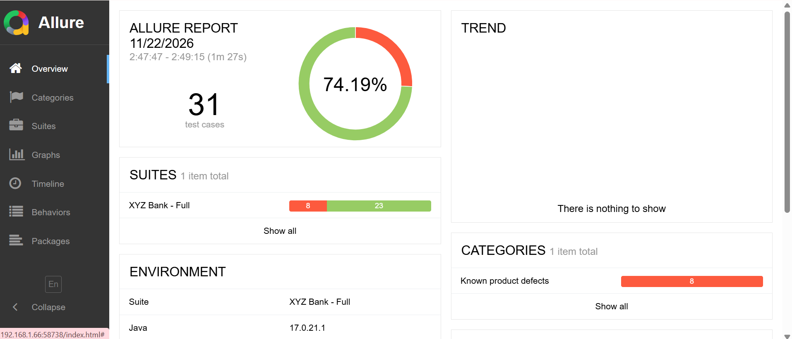
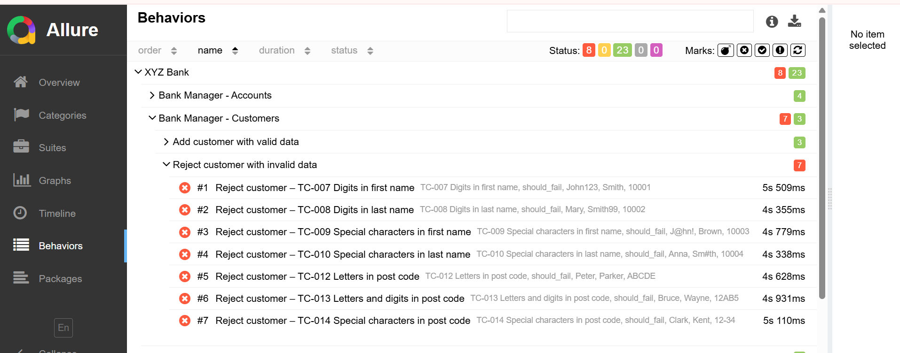
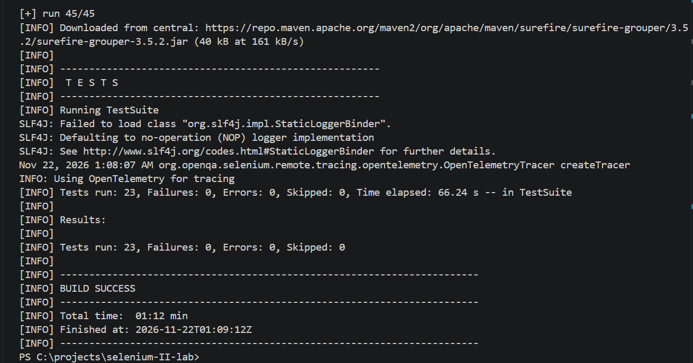
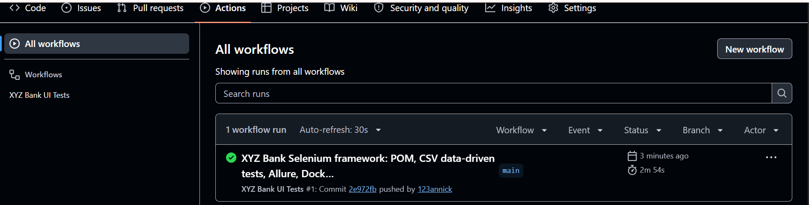

# XYZ Bank — UI Test Automation with Selenium WebDriver

[](https://github.com/123annick/selenium-II-lab/actions/workflows/ci.yml)


End-to-end UI test automation for the [XYZ Bank demo application](https://www.globalsqa.com/angularJs-protractor/BankingProject/), built with **Java, Selenium WebDriver, TestNG and Maven** using the **Page Object Model** and **CSV data-driven tests**. Tests run locally, in **Docker** against a Selenium Grid container, and in a **GitHub Actions** pipeline that publishes an **Allure report**.

| | |
| --- | --- |
| **Live Allure report** | https://123annick.github.io/selenium-II-lab/ |
| **Test plan** | [docs/Test_Plan_XYZ_Bank.pdf](docs/Test_Plan_XYZ_Bank.pdf) · [docs/TEST_PLAN.md](docs/TEST_PLAN.md) |
| **Manual testing (Jira Xray)** | Test Plan [TMLD4-104](https://amali-tech.atlassian.net/browse/TMLD4-104) · Test Execution [TMLD4-113](https://amali-tech.atlassian.net/browse/TMLD4-113) · [workbook and traceability reports](docs/) |
| **Author** | Annick Ujeneza |

---

## Contents

- [Scope](#scope)
- [Results](#results)
- [Tech stack](#tech-stack)
- [Project structure](#project-structure)
- [Framework design](#framework-design)
- [Getting started](#getting-started)
- [Docker](#docker)
- [CI/CD pipeline](#cicd-pipeline)
- [Allure reporting](#allure-reporting)
- [Manual testing and defects](#manual-testing-and-defects)
- [Lab deliverables](#lab-deliverables)
- [Discussion](#discussion)
- [Best practices applied](#best-practices-applied)

---

## Scope

The tests cover the two user stories of the lab and customer login from the project overview.

| User | Feature | Covered by |
| --- | --- | --- |
| Bank Manager (US-1) | Add customers; names letters only; post code digits only | [`AddCustomerTest`](src/test/java/com/xyzbank/tests/AddCustomerTest.java) |
| Bank Manager (US-1) | Create accounts; no access until an account exists; delete accounts; no access after deletion | [`AccountManagementTest`](src/test/java/com/xyzbank/tests/AccountManagementTest.java) |
| Customer | Login and logout | [`CustomerLoginTest`](src/test/java/com/xyzbank/tests/CustomerLoginTest.java) |
| Customer (US-2) | Deposit: positive amounts, balance update | [`DepositTest`](src/test/java/com/xyzbank/tests/DepositTest.java) |
| Customer (US-2) | Withdraw: positive amounts, sufficient balance, balance update | [`WithdrawTest`](src/test/java/com/xyzbank/tests/WithdrawTest.java) |
| Customer (US-2) | View transactions; history cannot be reset or altered | [`TransactionTest`](src/test/java/com/xyzbank/tests/TransactionTest.java) |

---

## Results

| Run | Tests | Passed | Failed | Notes |
| --- | --- | --- | --- | --- |
| Regression suite (CI quality gate) | 23 | 23 | 0 | Local, Docker and GitHub Actions |
| Full suite (published report) | 31 | 23 | 8 | The 8 failures prove open defects: invalid names and post codes are accepted (BUG-001 – BUG-007) and the transaction history can be reset (BUG-012) |
| Manual cycle (Xray TMLD4-113) | 64 | 43 | 20 | 1 not run (out of scope); see [Manual testing and defects](#manual-testing-and-defects) |

| Allure overview | Known defects |
| --- | --- |
|  |  |
| **Results by user story** | **Results by test class** |
|  |  |
| **Tests in Docker** | **GitHub Actions** |
|  |  |

---

## Tech stack

| Tool | Purpose |
| --- | --- |
| Java 17 · Maven | Language and build |
| Selenium WebDriver 4 | Browser automation (drivers resolved by Selenium Manager) |
| TestNG 7 | Test runner, data providers, groups, parallel execution |
| Apache Commons CSV | Reading test data files |
| Allure Report | Test reporting with steps, screenshots and links to Jira |
| Docker · Selenium Grid | Reproducible test execution |
| GitHub Actions · GitHub Pages | Continuous integration and report hosting |

---

## Project structure

```
selenium-II-lab/
├── .github/workflows/ci.yml        # CI pipeline: tests in Docker, Allure report to GitHub Pages
├── docs/                           # Test plan, manual-testing workbook, Xray reports, screenshots
├── src/test/java/com/xyzbank/
│   ├── base/                       # BaseTest: browser set-up and teardown
│   ├── config/                     # ConfigReader: properties with env/system overrides
│   ├── driver/                     # DriverFactory (local or Grid), DriverManager (ThreadLocal)
│   ├── pages/                      # Page Objects: locators and actions, no assertions
│   ├── tests/                      # Test classes: test logic and assertions only
│   ├── dataproviders/              # TestNG data providers backed by CSV files
│   ├── listeners/                  # Allure listener: screenshot on failure, environment info
│   └── utils/                      # CSV reader, unique test-data generator
├── src/test/resources/
│   ├── config.properties           # Base URL, browser, headless, Grid URL, timeouts
│   ├── allure.properties           # Results folder and Jira link patterns
│   ├── categories.json             # Allure failure categories
│   ├── suites/                     # smoke.xml · regression.xml · full.xml
│   └── testdata/                   # customer_login · add_customer · deposit · withdraw (CSV)
├── Dockerfile                      # Test-runner image (JDK + Maven)
├── docker-compose.yml              # Test runner + Selenium standalone Chrome
└── pom.xml
```

---

## Framework design

### Page Object Model

Each screen has one page class that owns its locators and actions. Tests never call WebDriver directly, and page methods return the next page, so tests read like the user story:

```java
@Test(dataProvider = "deposits", dataProviderClass = TestDataProviders.class, groups = {"smoke", "regression"})
public void deposit(String amount, String expectedOutcome, String description) {
    AccountPage account = openApp().goToCustomerLogin().loginAs(CUSTOMER);
    int balanceBefore = account.balance();

    account.deposit(amount);
    ...
}
```

[`BasePage`](src/test/java/com/xyzbank/pages/BasePage.java) holds shared explicit waits; implicit waits and `Thread.sleep` are not used.

### Data-driven tests

Test inputs and expected outcomes live in CSV files under [`src/test/resources/testdata`](src/test/resources/testdata). Each row runs as a separate test and appears in Allure under its description:

```csv
amount,expectedOutcome,description
100,should_pass,TC-043 Valid deposit updates balance
0,should_fail,TC-045 Zero deposit is not applied
-50,should_fail,TC-046 Negative deposit is not applied
```

### Test isolation

The application stores its data in the browser, so [`BaseTest`](src/test/java/com/xyzbank/base/BaseTest.java) opens a fresh browser for every test (`@BeforeMethod` / `@AfterMethod`). Tests that need a customer create a unique one. This keeps tests independent and safe to run in parallel.

### Test suites

| Suite | Tests | Purpose |
| --- | --- | --- |
| `smoke` | 20 | Quick check of the core flows |
| `regression` (default) | 23 | CI quality gate; excludes tests for open defects |
| `full` | 31 | Everything, including the `known-defect` group |

---

## Getting started

### Prerequisites

- JDK 17
- Maven 3.9+
- Google Chrome
- Docker Desktop (optional, for container runs)

### Run the tests

```bash
git clone https://github.com/123annick/selenium-II-lab.git
cd selenium-II-lab

mvn clean test                                   # regression suite (default)
mvn clean test -Dsuite=smoke                     # smoke suite
mvn clean test -Dsuite=full                      # all tests, including known defects
mvn clean test -Dheadless=true                   # without a visible browser
mvn clean test -Dtest=DepositTest                # a single test class
```

On Windows PowerShell, put each `-D` option in quotes, e.g. `mvn clean test "-Dsuite=full"`.

### Configuration

Settings are in [`config.properties`](src/test/resources/config.properties) and can be overridden with a system property (`-Dbrowser=edge`) or an environment variable (`BROWSER=edge`).

| Key | Default | Description |
| --- | --- | --- |
| `base.url` | XYZ Bank login page | Application URL |
| `browser` | `chrome` | `chrome`, `edge` or `firefox` |
| `headless` | `false` | Run without a visible browser |
| `grid.url` | *(empty)* | Selenium Grid URL; empty = local browser |
| `explicit.wait.seconds` | `10` | Explicit wait timeout |

---

## Docker

The test runner and the browser run in separate containers. The runner connects to Selenium standalone Chrome through `GRID_URL`.

```bash
docker compose build
docker compose run --rm tests                    # regression suite
docker compose run --rm tests -Dsuite=full       # another suite
docker compose down
```

Results are written to `target/allure-results` on the host. While tests run, the browser can be watched at http://localhost:7900 (password `secret`).

---

## CI/CD pipeline

[`.github/workflows/ci.yml`](.github/workflows/ci.yml) runs on every push and pull request, nightly, and on demand.

```
build Docker image
   └─ run regression suite in Docker ──── quality gate (fails the build on any failure)
   └─ run full suite in Docker ────────── results for the report (known failures allowed)
        └─ generate Allure report with history ── upload as artifact
             └─ deploy to GitHub Pages (main branch)
```

The report is generated even when tests fail, and the suite can be chosen when running the workflow manually.

---

## Allure reporting

- `@Step` on page methods, so every test shows readable steps (e.g. *Log in as customer 'Harry Potter'*)
- `@Epic`, `@Feature`, `@Story` and `@Severity` to group results by user story
- `@TmsLink` and `@Issue` linking each test to its Xray test and Jira bug
- Screenshot, page source and URL attached automatically on failure
- Environment details and failure categories ("Known product defects", timeouts, locator problems)
- Trend history across CI runs

Generate the report locally:

```bash
mvn clean test -Dsuite=full
mvn allure:serve
```

---

## Manual testing and defects

Manual testing was done in Jira Xray before automation. Test cases, the traceability matrix and the defect log with screenshots are in [`docs/`](docs/); the automated CSV data reuses the manual test values.

### Defects against the lab's acceptance criteria

| Acceptance criterion | Bug | Jira | Summary | Severity |
| --- | --- | --- | --- | --- |
| US-1: names contain letters only | BUG-001 | [TMLD4-84](https://amali-tech.atlassian.net/browse/TMLD4-84) | First Name accepts digits | Medium |
| | BUG-002 | [TMLD4-85](https://amali-tech.atlassian.net/browse/TMLD4-85) | Last Name accepts digits | Medium |
| | BUG-003 | [TMLD4-86](https://amali-tech.atlassian.net/browse/TMLD4-86) | First Name accepts special characters | Medium |
| | BUG-004 | [TMLD4-87](https://amali-tech.atlassian.net/browse/TMLD4-87) | Last Name accepts special characters | Medium |
| US-1: post code contains digits only | BUG-005 | [TMLD4-88](https://amali-tech.atlassian.net/browse/TMLD4-88) | Post Code accepts letters | Medium |
| | BUG-006 | [TMLD4-89](https://amali-tech.atlassian.net/browse/TMLD4-89) | Post Code accepts letters and digits mixed | Medium |
| | BUG-007 | [TMLD4-90](https://amali-tech.atlassian.net/browse/TMLD4-90) | Post Code accepts special characters | Medium |
| US-1: managers can delete accounts | BUG-008 | [TMLD4-91](https://amali-tech.atlassian.net/browse/TMLD4-91) | No single-account delete; Delete removes the customer and all accounts | High |
| US-2: history cannot be reset or altered | BUG-012 | [TMLD4-95](https://amali-tech.atlassian.net/browse/TMLD4-95) | Customer can clear the transaction history with Reset | Critical |
| US-2: deposit amount validated | BUG-017 | [TMLD4-100](https://amali-tech.atlassian.net/browse/TMLD4-100) | Deposit of 0: no validation message | Low |
| | BUG-018 | [TMLD4-101](https://amali-tech.atlassian.net/browse/TMLD4-101) | Negative deposit: no validation message | Low |
| US-2: withdrawal amount validated | BUG-019 | [TMLD4-102](https://amali-tech.atlassian.net/browse/TMLD4-102) | Withdrawal of 0: no validation message | Low |
| | BUG-020 | [TMLD4-103](https://amali-tech.atlassian.net/browse/TMLD4-103) | Negative withdrawal: no validation message | Low |

For zero and negative amounts (BUG-017 – BUG-020) the app moves no money but shows no message, so the automated tests assert that the balance is unchanged and these rows pass.

<details>
<summary><b>Additional observations (beyond the lab's user stories)</b></summary>

Logged in Jira during exploratory testing; not acceptance criteria of this lab and not automated.

| Bug | Jira | Summary | Severity |
| --- | --- | --- | --- |
| BUG-009 | [TMLD4-92](https://amali-tech.atlassian.net/browse/TMLD4-92) | Customer deleted immediately, no confirmation | High |
| BUG-010 | [TMLD4-93](https://amali-tech.atlassian.net/browse/TMLD4-93) | Customer login needs no password | Critical |
| BUG-011 | [TMLD4-94](https://amali-tech.atlassian.net/browse/TMLD4-94) | Manager functions reachable without credentials | Critical |
| BUG-013 | [TMLD4-96](https://amali-tech.atlassian.net/browse/TMLD4-96) | Deposit rejects decimal amounts | Medium |
| BUG-014 | [TMLD4-97](https://amali-tech.atlassian.net/browse/TMLD4-97) | Withdrawal rejects decimal amounts | Medium |
| BUG-015 | [TMLD4-98](https://amali-tech.atlassian.net/browse/TMLD4-98) | Button label misspelled "Withdrawl" | Low |
| BUG-016 | [TMLD4-99](https://amali-tech.atlassian.net/browse/TMLD4-99) | "Deposit Successful" shown in red error style | Low |

</details>

**Finding from automation:** the Transactions list is sometimes empty because the app pre-fills its date filters with times that include milliseconds, which the date fields reject, so every row is hidden. [`TransactionsPage`](src/test/java/com/xyzbank/pages/TransactionsPage.java) widens the date range before checking rows. Candidate defect BUG-021.

---

## Lab deliverables

| Requirement | Where |
| --- | --- |
| Test plan (10 pts) | [docs/Test_Plan_XYZ_Bank.pdf](docs/Test_Plan_XYZ_Bank.pdf) |
| Set-up and POM folder structure | [Project structure](#project-structure), [`pages/`](src/test/java/com/xyzbank/pages) |
| Test data | [`testdata/`](src/test/resources/testdata) |
| GitHub Actions CI pipeline | [`ci.yml`](.github/workflows/ci.yml) |
| Containerization with Docker | [`Dockerfile`](Dockerfile), [`docker-compose.yml`](docker-compose.yml) |
| Allure report (20 pts) | [Live report](https://123annick.github.io/selenium-II-lab/) |
| Practice task 1 – POM refactor | [`BaseTest`](src/test/java/com/xyzbank/base/BaseTest.java), [`CustomerLoginPage`](src/test/java/com/xyzbank/pages/CustomerLoginPage.java), [`CustomerLoginTest`](src/test/java/com/xyzbank/tests/CustomerLoginTest.java) |
| Practice task 2 – data-driven test | [`customer_login.csv`](src/test/resources/testdata/customer_login.csv), [`TestDataProviders`](src/test/java/com/xyzbank/dataproviders/TestDataProviders.java) |
| Practice task 3 – Allure with `@Step` | [`pages/`](src/test/java/com/xyzbank/pages), [Allure reporting](#allure-reporting) |

> **Note on `@BeforeMethod`:** the practice task mentions `@BeforeTest`. A fresh browser per test method is used instead, because the app keeps its data in the browser; sharing one browser would let one test's data affect the next.

---

## Discussion

### Prioritization challenge — POM or data-driven testing first?

I would get the **Page Object Model** right first.

In a big project the thing that changes most often is the user interface. Buttons get renamed, forms move, new fields appear. With POM, every locator lives in one page class, so when the Deposit button changes I fix it once in `AccountPage` and every test that deposits money keeps working. Without POM, the same locator is copied into dozens of tests and one UI change can break all of them. Over a year, that is where most of the maintenance time goes.

Data-driven testing is important too, but it sits on top of POM. A data-driven test runs the same steps with different values, and those steps are exactly the page methods like `loginAs()`, `deposit()` and `withdraw()`. If the page objects are clean, adding a CSV file is easy: in this project it was one reader class, one data provider and a few CSV files. Going the other way is much harder. Adding POM later to hundreds of tests that already contain raw WebDriver code means rewriting them.

So POM controls the cost of maintenance as the number of tests grows, while data-driven testing increases coverage. I would build the POM properly from day one and add data-driven tests wherever a flow needs many input combinations, like deposits, withdrawals and customer validation in this lab.

### Reporting goal — one piece of information for a non-technical Product Owner

The most useful thing for a Product Owner is seeing **results grouped by user story, with severity** — the Behaviors view in Allure.

A Product Owner does not think in Java classes; they think in features and acceptance criteria. In my report they can open *Customer – Transactions* and see straight away that "Customer cannot reset transaction history" failed, that it is marked Critical, and that it links to the Jira bug TMLD4-95. The steps are written in plain language ("Log in as customer 'Harry Potter'", "Click 'Reset'") and there is a screenshot, so they understand the problem without reading any code.

That lets them answer the questions they actually care about: which acceptance criteria are met, which are not, and whether a failure should stop the release. Together with the trend graph, they can also see if quality is getting better from one build to the next.

---

## Best practices applied

- Page Object Model with strict layers: pages act, tests assert
- Fluent page navigation (page methods return the next page)
- Explicit waits only; no `Thread.sleep`, no implicit waits
- Stable locators (`id`, `ng-model`, `ng-click`); no absolute XPath
- Fresh browser per test and unique test data: independent, parallel-safe tests
- `ThreadLocal` WebDriver for parallel execution
- Selenium Manager: no driver binaries in the repository
- Configuration outside the code, overridable by environment variables
- Test data in CSV files with positive, negative and boundary values
- Open defects tracked by tests linked to Jira, without blocking the CI gate
- Docker image with a cached dependency layer; separate Selenium Grid container
- Reports published even when tests fail
- Meaningful assertion messages
